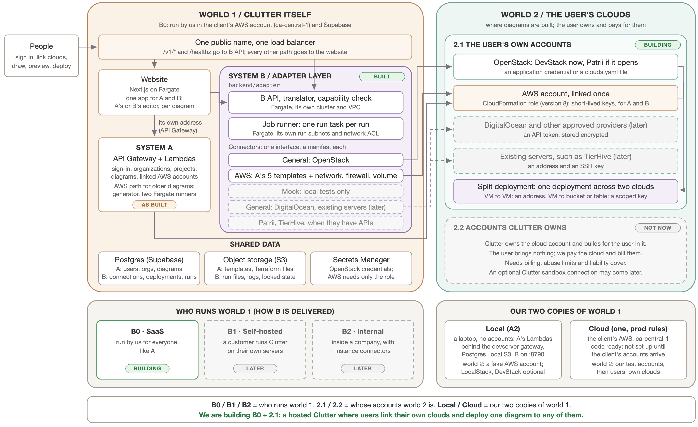

# Clutter

Clutter is a drag-and-drop canvas for cloud architecture. You draw a diagram (a Lambda, an S3 bucket, an EC2 server, with lines between them), and Clutter turns it into Terraform and Ansible and runs it inside your own cloud account.

It began as a University of Calgary capstone (team 500-MM-3, 2025 to 2026) for Alberta 2514640 Inc. A previous capstone team built that version, which works with AWS only. We are the new team. We are extending it into one hosted product where users link their own clouds and deploy one diagram to any of them: AWS, OpenStack (and Patrii Cloud once it opens), and more over time. The new part that talks to each cloud is the adapter layer.


This page gets you from a fresh clone to a working setup, and shows where everything lives. Read it once, top to bottom.

## Quick start

On macOS (Apple Silicon or Intel) or Linux, clone the repo, then run three commands from its root:

```bash
git clone https://github.com/FayzanT/re-clutter && cd re-clutter
npm run doctor   # checks your tools; a FAIL line gives the install command for your machine
npm run setup    # installs the packages and fills the caches (a few minutes the first time)
npm run dev      # starts the database, the backend and the website; Ctrl+C stops them
```

What you should see:

1. `npm run doctor` prints one line per tool and ends with `Ready`. Install whatever it marks `FAIL` (the line under it says how), open a new terminal, and run it again. It installs nothing itself.
2. `npm run setup` prints five numbered steps (the first runs the doctor again), and ends with `Ready. Run: npm run dev`. It is safe to run again.
3. `npm run dev` prints where to go once the backend is up, and the website is ready when Next.js prints `Ready`. Open <http://localhost:3000>, and sign in at <http://localhost:3000/dev/login> as a local test user (Google sign-in works too). For sample data, run `npm run seed` in another terminal.

Every command takes `--help`. The tools and their install commands are in [Set up](#set-up); what to do next in the app is in [A full local tour](#4-a-full-local-tour).

## Where the project stands

| | |
| --- | --- |
| **System A** (Clutter as built, AWS only) | Complete and tested by the capstone team. Its AWS hosting has been torn down. It runs locally through `backend/devserver`, except the parts that need AWS (deploy and running Ansible). Stage 1's security fixes are in code on the `impl/b0` branch; the customer role and runner fixes still need a real AWS account to confirm them. |
| **System B** (the adapter layer) | Built on `impl/b0` for stages 3 to 6: B's service in `backend/adapter`, the OpenStack and AWS connectors, B's editor, the Connections page and the deploy panel. The OpenStack connector's real test on DevStack and B's AWS test on LocalStack pass, and so do plan, deploy and destroy from the browser on both (2026-11-14). Stage 7 (the cloud) is written in the platform Terraform and waits for the client's accounts. The build order is `docs/architecture/implementation-plan.md`; each stage's status is in `.claude/findings/NOW.md`. |
| **Local checks** (2026-11-14) | Go: `backend/api` 30 packages ok, `backend/adapter` 18 ok, `backend/devserver` 3 ok. Frontend: 21 test files, 139 tests pass. Smoke: A covers all 32 routes in 39 calls (31 pass, 3 need AWS, 5 expected failures, 0 fail), and B passes 32 of 32 checks. Expected output is in `backend/README.md` and `frontend/clutter/README.md`. |
| **Open defects** | Some defects in A are still open, including shared runner credentials. They are listed in `.claude/findings/NOW.md`. Read that before you build on any A code path. |

## How Clutter fits together



This is a summary for new people, and every line links to the doc that owns the fact. `docs/architecture/system-b-adapter-layer.md` § Names defines every name the team uses (C, A, A2, B, B0, B1, B2, world 1, world 2, 2.1, 2.2, connector, General, connection, deployment, building blocks, seam, phase 0 and stage). An ADR is one architecture decision record in `docs/decisions.md`.

### What the user sees

One hosted product. A user signs in, links the clouds they already have on the Connections page, draws one diagram in building blocks (VM, network, firewall, volume, bucket, function, table, HTTP API), and deploys it to any linked cloud. Each cloud a diagram runs on is a **deployment**, with its own settings, Terraform state and run history. A cloud that cannot build a block says so, and the user leaves that block out of that deployment. Design: `docs/architecture/system-b-adapter-layer.md` § What the user sees.

### The two worlds

- **World 1** is Clutter itself: the website, the APIs, the database, the storage and the runners. We run it, in the client's AWS account.
- **World 2** is where diagrams are built: the users' own cloud accounts, which they link to Clutter (**2.1**). Clutter owning clouds and reselling them (**2.2**) is not in scope (ADR-013).

### The systems

**C = A + A2 + B** (ADR-011).

- **A** is Clutter as the previous team built it, AWS only: a Next.js website, 34 Go Lambdas (32 API routes, an authorizer and a queue consumer) behind AWS API Gateway, Postgres on Supabase, S3, and two Fargate runners. One runner runs Terraform in the customer's AWS account; the other runs Ansible on the customer's EC2 servers over SSM. A keeps serving existing AWS diagrams. Owner: `docs/architecture/system-a-as-built.md`.
- **A2** runs A, and B beside it, on a laptop with no AWS (`backend/devserver`). It is for the team, not for users. Owner: `backend/devserver/README.md`.
- **B** is the adapter layer: new code beside A, not a rewrite of A (Option 1, ADR-006). It is one Go service with its own `/v1` API, a connector interface, and one connector per kind of cloud: General's connectors (one per approved Terraform provider, OpenStack first, DigitalOcean next) and AWS, which reuses A's templates. Patrii and TierHive arrive when they have APIs, through General where they offer a standard provider. Owner: `docs/architecture/system-b-adapter-layer.md`; its code and settings: `backend/adapter/README.md`.
- **Who runs world 1:** **B0** (us, as a hosted service) is what we build. **B1** (a customer runs Clutter on their own servers) comes later with the same connectors. **B2** (inside a company, with its own connectors) is later still, and a separate decision (ADR-007).
- **Where it runs for us:** local (a laptop, no accounts) and one cloud environment in `ca-central-1` (ADR-015). Owner: `docs/architecture/environments.md`.
- **Later:** A and B become one system, C, with one API and one deploy path, once B passes on real AWS (ADR-021).

### The principles

- **Tenant isolation comes first.** Every request proves the caller belongs to the organization and that every id it names belongs to that organization (root `CLAUDE.md` § Boundaries).
- **User input never reaches generated code unescaped,** and customer credentials never reach a log or a response (root `CLAUDE.md` § Boundaries, ADR-016).
- **Terraform is the engine for every cloud** (ADR-002), and only Clutter writes the Terraform a run uses (ADR-017).
- **Capabilities, not a lowest common denominator:** each connector says what it can build, and the user sees it before anything runs (ADR-001).
- **B's core never names a connector;** a new cloud is a new connector, not a change to the core (`system-b-adapter-layer.md` § General).
- **A changes only at named seams** (ADR-006, `system-b-adapter-layer.md` § The seams).
- **One owner per fact,** in the code and in the docs (`docs/README.md`).
- **A person deploys;** no script or AI session applies to a cloud on its own (root `CLAUDE.md` § Boundaries).

### Every feature, and where it lives

| Feature | Where it lives | Owner doc |
| --- | --- | --- |
| Sign in with Google, organizations, projects, saving diagrams | A's Lambdas in `backend/api`; B checks the same sign-in token | `system-a-as-built.md` |
| The website: landing page, dashboard, settings, organization switcher | `frontend/clutter`, one app for A and B (ADR-024) | `frontend/clutter/README.md` |
| Link an AWS account (a CloudFormation link creates a role) | A's account-link routes; B reads those links as AWS connections | `system-a-as-built.md` § The main flows |
| The Connections page: link any cloud, verified before it is saved | B's `/v1` connections routes and B's screens | `system-b-adapter-layer.md` § The Connections page |
| The building-block editor | B's screens in `frontend/clutter`, for diagrams marked `engine: "blocks"` | `frontend/clutter/README.md` § B's screens |
| A's AWS editor, for older AWS diagrams | `frontend/clutter`, with generation in `backend/api/terraform-engine/create` | `system-a-as-built.md` |
| Deployments, the capability check and the deploy panel | B's service and B's screens | `system-b-adapter-layer.md` § One diagram, many deployments |
| One deployment split across clouds, with scoped keys | B's service (ADR-020) | `system-b-adapter-layer.md` § Split deployments |
| Terraform preview | A's editor (ADR-012); B's deploy panel per deployment | `system-a-as-built.md`, `backend/adapter/README.md` § Routes |
| Function code upload | B's service | `backend/adapter/README.md` § Function code |
| Server setup at first boot (cloud-init) | B's connectors; A uses Ansible over SSM instead | `backend/adapter/README.md` § Server setup at first boot |
| Isolated runs: one short-lived task per run, with only that run's credentials | B's run task (ADR-017) | `system-b-adapter-layer.md` § Isolating the runner |
| Running everything on a laptop, with LocalStack for AWS and DevStack for OpenStack | A2 (`backend/devserver`) | `backend/devserver/README.md` |
| Deploying Clutter itself to the cloud | the platform Terraform in `backend/infra` and `npm run deploy` | `docs/architecture/environments.md` |

AWS terms you will meet in A: Lambda (a function AWS runs on request), API Gateway (AWS's HTTP front door), Fargate (AWS running a container on demand), STS (AWS issuing short-lived credentials for another account's role), SSM (AWS running a command on a server without SSH), S3 (file storage), SQS (a queue).

## What is in the repo

```text
backend/
  adapter/          B, the adapter layer: its API (cmd/api), run task (cmd/runtask), connectors and images
  api/              A's Go Lambdas, one folder per route; generic/ is shared code (B imports it too)
    terraform-engine/create/   A's generator: diagram JSON to Terraform
  infra/            Terraform that deploys Clutter itself (A, B and the website) into Clutter's AWS account
    modules/s3/uploads/        the customer Terraform templates (*.tf.tmpl) and the customer role
    modules/fargate/ecr-scripts/   A's two runner images
    modules/adapter-service/   B in the cloud: its network, cluster, load balancer, buckets and roles
    modules/website/           the website in the cloud
  infra-state-bootstrap/   creates the bucket and lock table for infra/'s own state
  storage-sql/      A's Postgres schema and resource seed, and B's tables (adapter-tables.sql)
  devserver/        A2, dev-only: runs A's real Lambdas behind an API Gateway stand-in, and B beside them
frontend/
  clutter/          the Next.js website for A and B (landing page, dashboard, both editors, settings)
  design/           the colour palette, as exported swatches
  Dockerfile.frontend, build-image.sh   the website's image
docs/
  README.md         the map: which file owns which fact
  architecture/
    system-a-as-built.md       A: what exists today
    system-b-adapter-layer.md  B: the design, and its names
    implementation-plan.md     the build order: stages, tests, "done when"
    environments.md            local vs cloud: what differs and what each needs
    figures/                   clutter-worlds.png and the editor screenshot, with their sources
    system-b-team-plan/        the team's own B plan: figures, PDF and the written explanation
  decisions.md      every decision and why (ADR-001 onward; ADR means architecture decision record)
  research/
    patricloud/     dated research on PatriCloud (and a second research run)
    tierhive/       dated research on TierHive
    openstack/      DevStack on a laptop, and one diagram rendered for two clouds
    aws/            LocalStack, an AWS stand-in on a laptop
  old-capstone/     the previous capstone team's final report (PDF and markdown) and backend tutorial
.claude/            the Claude Code setup (its README says what each part is)
  findings/NOW.md   the status board: next tasks, open defects, open questions (everyone reads this)
CLAUDE.md, AGENTS.md        rules for AI coding agents; skim them, they are written for agents
```

There are two kinds of Terraform here. `backend/infra` deploys Clutter itself. The `*.tf.tmpl` files are templates the generator fills in for a customer. They never stand in for each other.

## Set up

### 1. Install the tools

`npm` cannot install Go, and `go` cannot install Node. Each language needs its own installer first. After that, `npm run setup` installs the repo's own packages. `npm run doctor` checks everything in this table that the local run uses, and prints the install command for your platform.

| Tool | Version | Needed for |
| --- | --- | --- |
| macOS (tested) or Linux; Windows only through WSL (untested) | | |
| Git and GitHub CLI (`gh`) | any recent | clone, branches, pull requests |
| Go | the `go` line of the `go.mod` files (1.25.3) or newer. Go 1.21 or newer downloads that version by itself, unless `GOTOOLCHAIN=local` (Fedora's packaged Go sets it) | the backend |
| Node.js with npm | the version in `.nvmrc` (22) or newer; CI uses 22 | the frontend. Use npm |
| Docker, running, with its compose plugin | any recent | the local database. On macOS, Docker Desktop (`brew install docker` is only the CLI and is not enough). On Linux, Docker Engine, and your user in the `docker` group |
| curl, openssl | macOS has them | the local run scripts |
| python3 | macOS has it with Apple's command line tools | `npm run seed` |
| Terraform | 1.14.4 or newer (the version B's run image uses) | B's local deploys and `npm run generated`, not the app itself |
| Lima | optional | DevStack, an OpenStack on your machine (`backend/devserver/README.md` § OpenStack on this machine (DevStack)) |
| Playwright's Chromium | optional | browser tests (`npx --prefix frontend/clutter playwright install chromium`) |
| AWS CLI | v2 | only for deploying, which nobody does from a laptop yet |
| Claude Code, and `jq` | optional | the AI setup in `.claude/` (its hooks need `jq`) |

**macOS**, with [Homebrew](https://brew.sh). If `brew` is missing, install it from that page, then:

```bash
xcode-select --install                         # Apple's Git and compilers; skip if already installed
brew install git gh go node jq
brew install hashicorp/tap/terraform           # Hashicorp's formula; Homebrew core no longer ships terraform
brew install --cask docker-desktop             # then open Docker.app and wait until it says it is running
```

`brew install node` puts `node` and `npm` on your PATH. That is not the same as the project's JavaScript packages.

**Linux.** Install the same tools from the vendor pages, not from an old distro package of Go or Node: [Go](https://go.dev/doc/install), [Node](https://nodejs.org/en/download), [Docker Engine](https://docs.docker.com/engine/install/), [Terraform](https://developer.hashicorp.com/terraform/install), [GitHub CLI](https://cli.github.com/). Then start Docker (`sudo systemctl start docker`, or your distro's equivalent), and let your user run it without sudo ([Docker's post-install steps](https://docs.docker.com/engine/install/linux-postinstall/)).

**Check** with `npm run doctor` once the repo is cloned, in a new terminal so PATH has updated. Nothing in the repo is installed yet. That is step 2.

### 2. Clone and set up

We work in a fork (`origin`). Finished work merges into the client's repo (`upstream`) by pull request, never by a direct push. Clone the fork and run `npm run setup` as in [Quick start](#quick-start), and add the client's repo once:

```bash
git remote add upstream https://github.com/Alberta2514640/clutter
```

`npm run setup` runs the doctor, then `npm ci` for the frontend, which reads `frontend/clutter/package-lock.json` and fills `frontend/clutter/node_modules` at exact versions (it does not install Node itself). It downloads every Go module's dependencies, pinned by each `go.sum`, and builds each module once so the first `npm run dev` is quicker; you do not run `go get` by hand. It pulls the pinned Postgres image, and copies `frontend/clutter/.env.example` to `.env.local` when that file does not exist. A second run skips what is done.

### 3. Check that everything builds

Run from the repo root.

```bash
go -C backend/api build ./...
go -C backend/api vet ./...
go -C backend/api test ./...
go -C backend/adapter test ./...      # B; some tests skip without Docker or Terraform
npx --prefix frontend/clutter tsc --noEmit -p frontend/clutter
npm --prefix frontend/clutter run lint
NEXT_PUBLIC_API_ENDPOINT=http://localhost:9999 npm --prefix frontend/clutter run build
terraform -chdir=backend/infra fmt -check -recursive    # 6 of A's files fail today
go -C backend/devserver test ./...     # A2, the local run tool
(cd frontend/clutter && npx vitest run)   # 21 files, 139 tests
```

The expected result of each check, including the known `fmt` failure, is in `backend/README.md` and `frontend/clutter/README.md`. Every Go package must pass.

### 4. A full local tour

From a fresh clone to a real deploy and destroy on AWS (LocalStack) and OpenStack (DevStack), all on your machine. The details behind each step are in `backend/devserver/README.md`.

#### What runs, and when

| Part | Where | Started by | Needed |
| --- | --- | --- | --- |
| Postgres | Docker, port 54329 | `npm run dev` | always |
| A's Lambdas behind the local API gateway, with the local S3 | port 8787 | `npm run dev` | always |
| B API | port 8790 | `npm run dev` | always |
| The website | port 3000 (Next.js on 3100 behind it) | `npm run dev` | always |
| LocalStack, a stand-in for AWS | Docker, port 4566 | `npm run localstack -- start` | only for real AWS deploys |
| DevStack, a small OpenStack | the Lima VM `devstack` | `npm run devstack -- start` | only for OpenStack deploys |

- Start LocalStack before `npm run dev`: B chooses its AWS mode when it starts. If Clutter already runs, run `npm run dev` again; it restarts.
- `localstack` and `devstack` return when they are ready, so run them in a second terminal. DevStack can start at any time. The VM takes 12 GiB of memory, so on a 16 GB machine run one of the two at a time.
- The **Mock cloud** on Connections, and the `Mock` tags in the palette, are a local test cloud. It builds nothing.
- Three ways to run Clutter: `npm run dev` (all of it, in one terminal); `npm run dev:backend`, then `npm run dev:frontend` in a second terminal; or the website alone with no backend (`frontend/clutter/README.md` § Run it).
- One copy of Clutter runs per machine. Every clone shares the ports and the database, so a second clone starts with `npm run stop -- --wipe`.

#### AWS, on LocalStack

1. `npm run doctor`: one line per tool, ending with `Ready: everything Clutter needs is here.`
2. `npm run setup`: five numbered steps, ending with `Ready. Run: npm run dev`.
3. `npm run dev`: a start message, then Next.js prints `Ready`. Its `AWS:` line says runs need a real AWS account, and how to change that.
4. Open <http://localhost:3000/dev/login>: you are signed in as a local test user, on "Create your organization".
5. Name the organization and press **Create organization**: the dashboard. Press **New Project**, name it, press **Create Project**: the project's page.
6. In a second terminal, run `npm run localstack -- start` (it ends with `LocalStack is ready`), then `npm run dev` in the same terminal. The `AWS:` line now says `AWS runs apply against LocalStack`. The first terminal prints `Stopping the website, the backend and the database`: that is the expected restart.
7. **Connections** in the sidebar, then **Amazon Web Services**, then **Link fake account**: `localfake… is linked and chosen above`. Press **Check and connect**: `Connected localfake…. Clutter checked it and it works.`
8. Open the project and press **New diagram**: the building-block editor.
9. Click **VM** and **Network** in the palette, and drag them apart if they land together. Then drag from the VM's right dot to the network's left dot: a line joins them. Press **Save**: the top bar says `Saved`.
10. The **Deploy** tab, **Add deployment**, the AWS connection, then **Add deployment to localfake…**: `Amazon Web Services: every block can be built here`.
11. **Preview Terraform**: five files, `main.tf` among them.
12. **Plan**: `Plan: 6 to add`. **Deploy**: `Apply complete: 6 added`, and the badge says `Deployed`.
13. **Destroy**, then **Destroy for good**: `Destroy complete: 6 destroyed`, and the badge says `Destroyed`.

#### OpenStack, on DevStack

Needs a Mac with 16 GB of memory or more (`backend/devserver/README.md` § OpenStack on this machine (DevStack)). On a 16 GB machine, run `npm run localstack -- stop` first.

1. `npm run devstack -- create`: once, 10 to 20 minutes. It ends with `DevStack runs in the devstack VM.`
2. `npm run doctor`: a line says `DevStack answers at http://<the VM's address>/identity/v3`. If it does not, allow your terminal app in macOS's Local Network settings (§ Let this machine reach the VM (macOS) in the same README), then run the doctor again.
3. `npm run devstack -- credential`, in a terminal: it prints a region, an auth URL, an application credential ID and a secret. The secret is shown once. Running it again replaces the credential, so delete the OpenStack connection and add it again with the new values.
4. **Connections**, then **OpenStack**: fill in a connection name and the four printed values, then **Check and connect**: `Connected …. Clutter checked it and it works.`
5. In the diagram's **Deploy** tab, **Add deployment** with the OpenStack connection. With the VM and Network diagram: **Preview Terraform** shows three files (`main.tf`, `outputs.tf`, `versions.tf`), **Plan** says `Plan: 5 to add`, **Deploy** says `Apply complete: 5 added`, and **Destroy** says `Destroy complete: 5 destroyed`.

In later sessions, `npm run devstack -- start` starts the VM, and `npm run doctor` shows whether OpenStack answers.

#### A's older editor, and the end

1. `npm run seed`: it prints `Open diagram:` and a link. The link opens A's older AWS editor with 5 nodes. Press **Save** first: Preview and Deploy stay off until then. Deploy then shows `Clutter could not start the deploy.` locally; that is expected, because it needs real AWS.
2. `npm run smoke`: A's summary ends with `FAIL 0`, and B's says `B checks: 32  PASS 32  FAIL 0`.
3. `npm run stop`, then `npm run localstack -- stop` (and `npm run devstack -- stop`): your data is kept. Add `-- --wipe` to `npm run stop` to delete it.

Frontend edits reload by themselves. After editing Go code, run `npm run dev` again.

Every command below takes `--help`.

| Command | Does |
| --- | --- |
| `npm run doctor` | checks your tools, ports and disk, and says how to install what is missing |
| `npm run setup` | installs the packages and fills the caches; safe to run again |
| `npm run dev` | starts everything; Ctrl+C stops it and keeps your data; a second run restarts it |
| `npm run dev:backend` | starts everything but the website, then returns |
| `npm run dev:frontend` | runs only the website, against `npm run dev:backend`; Ctrl+C stops only the website |
| `npm run seed` | creates a sample AWS diagram for the local test user |
| `npm run generated -- <diagram-id>` | for A's older diagrams: runs `terraform validate` on a diagram's generated files. The diagram id is the last part of the editor's address |
| `npm run smoke` | calls all 32 routes and B's main paths, and prints what passed (with `npm run dev` running) |
| `npm run stop` | stops whatever `npm run dev`, `dev:backend` or `dev:frontend` started, from any terminal |
| `npm run stop -- --wipe` | also deletes the local database, to start clean |
| `npm run localstack -- start\|stop\|status` | LocalStack, so B's AWS deployments apply on your machine (`backend/devserver/README.md`) |
| `npm run devstack -- create\|credential\|start\|stop\|status` | the Lima VM that runs DevStack, for B's OpenStack connector, and the credential Clutter uses (`backend/devserver/README.md`) |
| `npm run deploy:plan -- prod` | for later: shows what a cloud deploy would change (`docs/architecture/environments.md`) |

A has no backend server of its own, so this runs stand-ins for its AWS parts. `docs/architecture/system-a-as-built.md` § How A runs has the table of what is real and what stands in. What works locally and what does not is in `backend/devserver/README.md`.

Deploying and running Ansible need real AWS: `docs/architecture/environments.md` says what the cloud needs.

## Do not run

- `terraform plan` or `apply` in `backend/infra` by hand. A person deploys with `npm run deploy:plan` and `npm run deploy`, which pick the client's state backend and check the account first (`docs/architecture/environments.md` § Credentials day).

## Your first day

Read in this order:

1. This page.
2. `docs/architecture/system-a-as-built.md`: what A does, what the capstone delivered, and where the final report is wrong about the code.
3. `docs/architecture/figures/clutter-worlds.png`: the whole product in one picture.
4. `docs/architecture/system-b-adapter-layer.md`: what we are building and why.
5. `docs/architecture/implementation-plan.md`: the order it gets built in, and how each stage is tested.
6. `.claude/findings/NOW.md`: what is in progress, the open defects, the open questions.
7. `docs/decisions.md`: why things are the way they are.
8. `CLAUDE.md`: skim it. It is written for AI agents, but its "What you will get wrong" list is the fastest way to learn the traps.

Then pick a task from `NOW.md` § Next. Tell the team which one you are taking, so two people do not take the same one. A good first task is a minor defect from `NOW.md` § Open defects in A, such as making `application-tables.sql` safe to run twice: it is small, it touches no security path, and it teaches you the schema and the local run.

## How we work

- **Branches.** Branch off `main`. Never commit to `main` directly. Push your branch to our fork (`origin`), then open a pull request into the client's repo (`upstream`). Never push to `upstream` directly.
- **Taking a task.** The tasks are the tables in `.claude/findings/NOW.md` § Next. Put your name in a task's Owner cell in your branch's first commit and open a draft pull request at once, so two people never take the same task. The rules for editing `NOW.md` without merge conflicts are at the top of that section.
- **Before you open a pull request:**
  1. The checks in step 3 pass, and `npm run smoke` (with `npm run dev` running) shows 0 fail. GitHub runs these on every pull request too (`.github/workflows/checks.yml`).
  2. Docs whose facts you changed are updated (`docs/README.md` says which file owns which fact).
  3. A decision you made is in `docs/decisions.md`.
- **Decisions.** An ADR starts as "proposed" and becomes "accepted" when its pull request is approved by the team (and the client, for scope or hosting). Write it before the change it decides.
- **Commits.** Say what changed and why. One commit per finished change, after the checks pass.
- **Changing A.** New local and test abilities go in A2. Stage 1's changes to A are already decided (phase 0, and the moves in ADR-006's revision). Any other change to A is a decision: write it in `docs/decisions.md` first.
- **Security rules.** Read the root `CLAUDE.md` § Boundaries before touching a handler or a template.
- **Docs.** Each fact has one owner doc (`docs/README.md` has the map). When code changes a fact, update its owner in the same pull request. When a doc and the code disagree, the code wins and the doc gets fixed.
- **Adding a cloud resource or a new cloud.** Follow `.claude/skills/add-cloud-resource/SKILL.md`, even without Claude Code. It lists every place a resource is defined, and how a new cloud joins as a General connector (`docs/architecture/system-b-adapter-layer.md` § General).

### Claude Code

The `.claude/` folder sets up Claude Code for this repo. You do not need it. `.claude/README.md` says what each part does.

## Where to find things

`docs/README.md` maps every fact to the one file that owns it.

## History and license

The previous capstone team (500-MM-3, 2025 to 2026), who built A: Santiago Garza Fuentes (project manager), Hamza Amar, Maitra Patel, Nimna Wiedasa, Syril Jacob and Akshpreet Singh, advised by Lorenzo De Carli, for Devin Atkin at Alberta 2514640 Inc. Their final report is in `docs/old-capstone/`: the cover is dated 2026-04-12, and it was committed on 2026-06-08. Its figures were never committed.

The capstone code is released under the MIT License, copyright 2026 Alberta 2514640 Inc. The full text is at the end of the final report.
