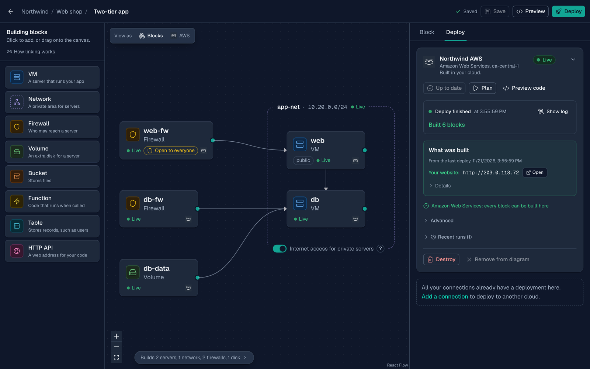

# Clutter

Clutter is a drag-and-drop canvas for cloud architecture. You draw a diagram in plain building blocks (a server, a network, a firewall, a bucket, a function, with lines between them), and Clutter turns it into Terraform and runs it inside your own cloud account.

It began as a University of Calgary capstone (team 500-MM-3, 2025 to 2026) for Alberta 2514640 Inc. A previous capstone team built that version, which works with AWS only. We are the new team. We are extending it into one hosted product where users link their own clouds and deploy one diagram to any of them: AWS, OpenStack (and Patrii Cloud once it opens), and more over time. The new part that talks to each cloud is the adapter layer.



This page gets you from a fresh clone to a working setup, and shows where everything lives. Read it once, top to bottom.

## Quick start

On macOS (Apple Silicon or Intel) or Linux, clone the repo, then run three commands from its root:

```bash
git clone https://github.com/FayzanT/re-clutter && cd re-clutter
npm run doctor   # checks your tools; a FAIL line gives the install command for your machine
npm run setup    # installs the packages and fills the caches (a few minutes the first time)
npm run dev      # starts the database, the backend and the website; Ctrl+C stops them
```

What you should see:

1. `npm run doctor` prints one line per tool and ends with `Ready`. Install whatever it marks `FAIL` (the line under it says how), open a new terminal, and run it again. It installs nothing. When the Postgres image is already pulled, it starts one throwaway container, with no network, to check that Docker works.
2. `npm run setup` prints five numbered steps (the first runs the doctor again), and ends with `Ready. Run: npm run dev`. It is safe to run again.
3. `npm run dev` prints where to go once the backend is up, and the website is ready when Next.js prints `Ready`. Open <http://localhost:3000>, and sign in at <http://localhost:3000/dev/login> as a local test user. Google sign-in at `/login` works too, while the capstone team's Google client exists (`backend/devserver/README.md` § How sign-in works locally).
4. `npm run seed`, in another terminal, adds one diagram for A's older AWS editor. For the building-block editor, choose an example under **New diagram**.

Every command takes `--help`. The tools and their install commands are in [Set up](#set-up); what to do next in the app is in [A full local tour](#4-a-full-local-tour).

## Ways to run Clutter

| Mode | What it builds | What you need | How to start | Cost |
| --- | --- | --- | --- | --- |
| Local, Mock cloud (a test cloud) | Nothing real. Use it for the screens and flows. | Node, Go, Docker | `npm run setup` once, then `npm run dev` | Free |
| AWS on LocalStack (a fake AWS in Docker) | AWS Terraform really applies, to a fake AWS on this machine. EC2 servers do not boot. | The local mode, and LocalStack (Docker) | `npm run localstack -- start`, then `npm run dev -- --aws localstack` | Free |
| OpenStack on DevStack (OpenStack's own test install) | A real small OpenStack, in a Lima VM on a Mac | The local mode, Lima, and a Mac with 16 GB of memory or more | `npm run devstack -- create` once (10 to 20 minutes), then `npm run devstack -- start`. `npm run devstack -- route` (asks for your password) lets the Mac open DevStack's servers. `npm run devstack -- credential` prints the connection values. | Free. The VM takes 4 CPUs and 12 GiB of memory. |
| Real clouds from a laptop | Real resources in your own AWS account and a real OpenStack project, such as VEXXHOST (a public OpenStack cloud) | Terraform, the AWS CLI v2 and an AWS administrator's profile; an OpenStack application credential | AWS: `npm run real-aws -- setup --admin-profile NAME` once, then `npm run dev -- --aws real`. OpenStack: add the application credential on Connections. | Costs money. Destroy what you build. |
| Hosted (prod) | Clutter itself, in AWS, in `ca-central-1` | The client's accounts | A person runs `npm run deploy:plan -- prod`, then `npm run deploy -- prod`. | Costs money. Not run yet. |

- **Which mode you are in:** `npm run dev` prints its AWS mode on its `AWS:` line at start. `npm run doctor` shows whether LocalStack and DevStack answer. `npm run real-aws -- status` shows whether this machine is set up for real AWS.
- **Only AWS has a mode (`--aws`).** Mock and OpenStack (DevStack or a real cloud) are connections you add on Connections, in any local mode.
- **`--aws`** takes `auto` (the default), `localstack` or `real`. With `auto`, `npm run dev` uses real AWS when `npm run real-aws -- setup` has run, then LocalStack when it answers. Otherwise AWS runs stop with "needs a real AWS account".
- **Details:** `backend/devserver/README.md` § AWS on LocalStack, § OpenStack on this machine (DevStack) and § Real clouds from this machine. For the hosted mode: `docs/architecture/environments.md` § Credentials day.

## Where the project stands

Where each stage (one step of the build order in `docs/architecture/implementation-plan.md`) stands, and the open defects in A, are in `.claude/findings/NOW.md`. Read its open defects before you build on any A code path.

## How Clutter fits together


This is a summary for new people, and every line links to the doc that owns the fact. `docs/architecture/system-b-adapter-layer.md` § Names defines every name the team uses (C, A, A2, B, B0, B1, B2, world 1, world 2, 2.1, 2.2, connector, General, connection, deployment, building blocks, seam, phase 0 and stage). An ADR is one architecture decision record in `docs/decisions.md`.

### What the user sees

One hosted product. A user signs in, links the clouds they already have on the Connections page, draws one diagram in building blocks (VM, network, firewall, volume, bucket, function, table, HTTP API), and deploys it to any linked cloud. Each cloud a diagram runs on is a **deployment**, with its own settings, Terraform state and run history. A cloud that cannot build a block says so, and the user leaves that block out of that deployment. Design: `docs/architecture/system-b-adapter-layer.md` § What the user sees.

### The two worlds

- **World 1** is Clutter itself: the website, the APIs, the database, the storage and the runners. We run it, in the client's AWS account.
- **World 2** is where diagrams are built: the users' own cloud accounts, which they link to Clutter (**2.1**). Clutter owning clouds and reselling them (**2.2**) is not in scope (ADR-013).

### The systems

**C = A + A2 + B** (ADR-011). `docs/architecture/system-b-adapter-layer.md` § Names defines each name. In one line each:

- **A** is Clutter as the previous team built it, AWS only (`docs/architecture/system-a-as-built.md`).
- **A2** runs A, and B beside it, on a laptop with no AWS. It is for the team, not for users (`backend/devserver/README.md`).
- **B** is the adapter layer: one Go service beside A, with one connector per kind of cloud (`backend/adapter/README.md`).
- **B0** is B hosted by us, which is what we build. B1 and B2 come later (ADR-007).
- **Where it runs for us:** local, and one cloud environment in `ca-central-1` (`docs/architecture/environments.md`).
- **Later:** A's AWS path retires and C becomes one service and one website (ADR-021).

### The principles

- **Tenant isolation comes first.** Every request proves the caller belongs to the organization and that every id it names belongs to that organization (root `CLAUDE.md` § Boundaries).
- **User input never reaches generated code unescaped,** and customer credentials never reach a log or a response (root `CLAUDE.md` § Boundaries, ADR-016).
- **Terraform is the engine for every cloud** (ADR-002), and only Clutter writes the Terraform a run uses (ADR-017).
- **Capabilities, not a lowest common denominator:** each connector says what it can build, and the user sees it before anything runs (ADR-001).
- **B's core never names a connector;** a new cloud is a new connector, not a change to the core (`system-b-adapter-layer.md` § General).
- **A changes only at named seams,** the few places where B touches A (ADR-006, `system-b-adapter-layer.md` § The seams).
- **One owner per fact,** in the code and in the docs (`docs/README.md`).
- **A person deploys;** no script or AI session applies to a cloud on its own (root `CLAUDE.md` § Boundaries).

### Every feature, and where it lives

| Feature | Where it lives | Owner doc |
| --- | --- | --- |
| Sign in with Google, organizations, projects, saving diagrams | A's Lambdas in `backend/api`; B checks the same sign-in token | `system-a-as-built.md` |
| The website: landing page, dashboard, settings, organization switcher | `frontend/clutter`, one app for A and B (ADR-024) | `frontend/clutter/README.md` |
| Link an AWS account (a CloudFormation link creates a role) | A's account-link routes; B reads those links as AWS connections | `system-a-as-built.md` § The main flows |
| The Connections page: link any cloud, verified before it is saved | B's `/v1` connections routes and B's screens | `system-b-adapter-layer.md` § The Connections page |
| The building-block editor | B's screens in `frontend/clutter`, for diagrams marked `engine: "blocks"` | `frontend/clutter/README.md` § B's screens |
| A's AWS editor, for older AWS diagrams | `frontend/clutter`, with generation in `backend/api/terraform-engine/create` | `system-a-as-built.md` |
| Deployments, the capability check and the deploy panel | B's service and B's screens | `system-b-adapter-layer.md` § One diagram, many deployments |
| One deployment split across clouds, with scoped keys | B's service (ADR-020) | `system-b-adapter-layer.md` § Split deployments |
| Terraform preview | A's editor (ADR-012); B's deploy panel per deployment | `system-a-as-built.md`, `backend/adapter/README.md` § Routes |
| Function code upload | B's service | `backend/adapter/README.md` § Function code |
| Server setup at first boot (cloud-init) | B's connectors; A uses Ansible over SSM instead | `backend/adapter/README.md` § Server setup at first boot |
| Isolated runs: one short-lived task per run, with only that run's credentials | B's run task (ADR-017) | `system-b-adapter-layer.md` § Isolating the runner |
| Running everything on a laptop, with LocalStack for AWS and DevStack for OpenStack | A2 (`backend/devserver`) | `backend/devserver/README.md` |
| Deploying Clutter itself to the cloud | the platform Terraform in `backend/infra` and `npm run deploy` | `docs/architecture/environments.md` |

### What happens when you press Deploy

One deploy through B, step by step. The design behind it is `docs/architecture/system-b-adapter-layer.md` § One deploy through B.

1. The deploy panel's card (`DeploymentRow`, in the building-block editor's `_components/blocks/` folder) calls `useStartRun`.
2. `startRun` in the frontend's `lib/features/deployments` sends `POST /v1/organizations/{orgID}/deployments/{deploymentID}/runs` to B.
3. B's `internal/api` package routes it to `createRun`, which checks the caller and the deployment, then calls `Enqueue`.
4. B's `internal/jobs` package queues the run, and a worker runs it in `execute`.
5. `execute` calls the connector's `Apply`, in `connectors/aws` or `connectors/generalopenstack`.
6. `Apply` renders the Terraform and hands it to the Terraform runner (`internal/terraform`).
7. Locally, Terraform runs as a child process of B (`internal/runtask`, `Local`). In the cloud, the whole run is one ECS task (`internal/runtask`, `LaunchRun`, running `cmd/runtask`).
8. The run's log goes to B's log store (`internal/logstore`). The deploy panel reads it from `GET /v1/organizations/{orgID}/runs/{runID}/logs`.

AWS terms you will meet in A: Lambda (a function AWS runs on request), API Gateway (AWS's HTTP front door), Fargate (AWS running a container on demand), STS (AWS issuing short-lived credentials for another account's role), SSM (AWS running a command on a server without SSH), S3 (file storage), SQS (a queue).

## What is in the repo

```text
backend/
  adapter/          B, the adapter layer: its API (cmd/api), run task (cmd/runtask), connectors and images
  api/              A's Go Lambdas, one folder per route; generic/ is shared code (B imports it too)
    terraform-engine/create/   A's generator: diagram JSON to Terraform
  infra/            Terraform that deploys Clutter itself (A, B and the website) into Clutter's AWS account
    modules/s3/uploads/        the customer Terraform templates (*.tf.tmpl) and the customer role
    modules/fargate/ecr-scripts/   A's two runner images
    modules/adapter-service/   B in the cloud: its network, cluster, load balancer, buckets and roles
    modules/website/           the website in the cloud
  infra-state-bootstrap/   creates the bucket and lock table for infra/'s own state
  storage-sql/      A's Postgres schema and resource seed, and B's tables (adapter-tables.sql)
  devserver/        A2, dev-only: runs A's real Lambdas behind an API Gateway stand-in, and B beside them
frontend/
  clutter/          the Next.js website for A and B (landing page, dashboard, both editors, settings)
  design/           the colour palette, as exported swatches
  Dockerfile.frontend, build-image.sh   the website's image
docs/
  README.md         the map: which file owns which fact
  architecture/
    system-a-as-built.md       A: what exists today
    system-b-adapter-layer.md  B: the design, and its names
    implementation-plan.md     the build order: stages, tests, "done when"
    environments.md            local vs cloud: what differs and what each needs
    figures/                   clutter-worlds.png, clutter-c.png and the editor screenshot (PNGs; no sources kept)
    system-b-team-plan/        the team's own B plan: figures, PDF and the written explanation
  reports/          dated test reports (PDF)
  decisions.md      every decision and why (ADR-001 onward; ADR means architecture decision record)
  research/
    patricloud/     dated research on Patrii Cloud (and a second research run)
    tierhive/       dated research on TierHive
    openstack/      DevStack on a laptop, and one diagram rendered for two clouds
    aws/            LocalStack, an AWS stand-in on a laptop
  old-capstone/     the previous capstone team's final report (PDF and markdown) and backend tutorial
test-suites/        the team's test plan: the index of every suite, run-all.sh and the platform check
deliverables/       the team's course deliverables (slides)
.claude/            the Claude Code setup (its README says what each part is)
  findings/NOW.md   the status board: next tasks, open defects, open questions (everyone reads this)
CLAUDE.md, AGENTS.md        rules for AI coding agents; skim them, they are written for agents
```

There are two kinds of Terraform here. `backend/infra` deploys Clutter itself. The `*.tf.tmpl` files are templates the generator fills in for a customer. They never stand in for each other.

## Set up

### 1. Install the tools

`npm` cannot install Go, and `go` cannot install Node. Each language needs its own installer first. After that, `npm run setup` installs the repo's own packages. `npm run doctor` checks everything in this table that the local run uses, and prints the install command for your platform.

| Tool | Version | Needed for |
| --- | --- | --- |
| macOS (tested) or Linux; Windows only through WSL (untested) | | |
| Git and GitHub CLI (`gh`) | any recent | clone, branches, pull requests |
| Go | the `go` line of the `go.mod` files (1.25.3) or newer. Go 1.21 or newer downloads that version by itself, unless `GOTOOLCHAIN=local` (Fedora's packaged Go sets it) | the backend |
| Node.js with npm | the version in `.nvmrc` (22) or newer; CI uses 22 | the frontend. Use npm |
| Docker, running, with its compose plugin | any recent | the local database. On macOS, Docker Desktop (`brew install docker` is only the CLI and is not enough). On Linux, Docker Engine, and your user in the `docker` group |
| curl, openssl | macOS has them | the local run scripts |
| python3 | macOS has it with Apple's command line tools | `npm run seed` |
| Terraform | 1.14.4 or newer (the version B's run image uses) | B's local deploys and `npm run generated`, not the app itself |
| Lima | optional | DevStack, an OpenStack on your machine (`backend/devserver/README.md` § OpenStack on this machine (DevStack)) |
| Playwright's Chromium | optional | browser tests (`npx --prefix frontend/clutter playwright install chromium`) |
| AWS CLI | v2, optional | `npm run real-aws` and deploying into your own AWS account (`backend/devserver/README.md` § Real clouds from this machine); not needed for LocalStack |
| Claude Code, and `jq` | optional | the AI setup in `.claude/` (its hooks need `jq`) |

**macOS**, with [Homebrew](https://brew.sh). If `brew` is missing, install it from that page, then:

```bash
xcode-select --install                         # Apple's Git and compilers; skip if already installed
brew install git gh go node jq
brew install hashicorp/tap/terraform           # Hashicorp's formula; Homebrew core no longer ships terraform
brew install --cask docker-desktop             # then open Docker.app and wait until it says it is running
brew install awscli                            # optional: only for your own AWS account
```

`brew install node` puts `node` and `npm` on your PATH. That is not the same as the project's JavaScript packages.

**Linux.** Install the same tools from the vendor pages, not from an old distro package of Go or Node: [Go](https://go.dev/doc/install), [Node](https://nodejs.org/en/download), [Docker Engine](https://docs.docker.com/engine/install/), [Terraform](https://developer.hashicorp.com/terraform/install), [GitHub CLI](https://cli.github.com/). Then start Docker (`sudo systemctl start docker`, or your distro's equivalent), and let your user run it without sudo ([Docker's post-install steps](https://docs.docker.com/engine/install/linux-postinstall/)).

**Check** with `npm run doctor` once the repo is cloned, in a new terminal so PATH has updated. Nothing in the repo is installed yet. That is step 2.

### 2. Clone and set up

We work in a fork (`origin`). [How we work](#how-we-work) says where pull requests go. Clone the fork and run `npm run setup` as in [Quick start](#quick-start), and add the client's repo (`upstream`) once:

```bash
git remote add upstream https://github.com/Alberta2514640/clutter
```

`npm run setup` runs the doctor, then `npm ci` for the frontend, which reads `frontend/clutter/package-lock.json` and fills `frontend/clutter/node_modules` at exact versions (it does not install Node itself). It downloads every Go module's dependencies, pinned by each `go.sum`, and builds each module once so the first `npm run dev` is quicker; you do not run `go get` by hand. It pulls the pinned Postgres image, and copies `frontend/clutter/.env.example` to `.env.local` when that file does not exist. A second run skips what is done.

### 3. Check that everything builds

Run from the repo root. These are the checks GitHub runs on every pull request (`.github/workflows/checks.yml`), in the same form.

```bash
go -C backend/api build ./...
go -C backend/api vet ./...
go -C backend/api test ./...
go -C backend/devserver vet ./...     # A2, the local run tool
go -C backend/devserver test ./...
go -C backend/adapter vet ./...       # B
go -C backend/adapter test ./...
npx --prefix frontend/clutter tsc --noEmit -p frontend/clutter
npm --prefix frontend/clutter run lint
(cd frontend/clutter && npx vitest run)   # the frontend's unit tests
NEXT_PUBLIC_API_ENDPOINT=http://localhost:8787 NEXT_PUBLIC_ADAPTER_API_ENDPOINT=http://localhost:8790 npm --prefix frontend/clutter run build
bash test-suites/scripts/platform-version/run.sh   # the pinned versions agree
npx -y markdownlint-cli2@0.18.1 "**/*.md"
backend/devserver/test-scripts.sh     # A2's scripts, against fake tools
backend/infra/test-deploy.sh          # npm run deploy's safety checks, against fake tools
.claude/hooks/test-hooks.sh           # needs jq
npm run dev:backend                   # then the smoke test, and stop
npm run smoke
npm run stop
```

- **Shellcheck:** CI runs `shellcheck -S warning` on the scripts its `docs-and-scripts` job lists. Root `CLAUDE.md` § Commands runs it through Docker.
- **B's Go tests** start a throwaway Postgres container on a random port. Without Docker, those tests skip. A few more skip without Terraform.
- **Not in CI:** `terraform -chdir=backend/infra fmt -check -recursive` (it has known failures), and the team's test plan, `bash test-suites/scripts/run-all.sh`.
- **The test plan needs a git clone,** not a copy of the files: each suite's script finds the repo with `git rev-parse --show-toplevel`. Its browser suite tests whatever answers at <http://localhost:3000>; set `CLUTTER_WEB_URL` to test another address (`test-suites/README.md`).

The expected result of each check is with its folder: `backend/README.md` (with the known `fmt` failures), `backend/adapter/README.md`, `backend/devserver/README.md` and `frontend/clutter/README.md`. Every Go package must pass.

### 4. A full local tour

To show Clutter to someone in about ten minutes, follow `docs/demo.md`.

From a fresh clone to a real deploy and destroy on AWS (LocalStack) and OpenStack (DevStack), all on your machine. The details behind each step are in `backend/devserver/README.md`.

If `npm run dev` already runs from the Quick start, run the tour's commands in a second terminal; `npm run dev` there restarts it.

#### What runs, and when

| Part | Where | Started by | Needed |
| --- | --- | --- | --- |
| Postgres | Docker, port 54329 | `npm run dev` | always |
| A's Lambdas behind the local API gateway, with the local S3 | port 8787 | `npm run dev` | always |
| B API | port 8790 | `npm run dev` | always |
| The website | port 3000 (Next.js on 3100 behind it) | `npm run dev` | always |
| LocalStack, a stand-in for AWS | Docker, port 4566 | `npm run localstack -- start` | only for real AWS deploys |
| DevStack, a small OpenStack | the Lima VM `devstack` | `npm run devstack -- start` | only for OpenStack deploys |

- Start LocalStack before `npm run dev`: B chooses its AWS mode when it starts. If Clutter already runs, run `npm run dev` again; it restarts. [Ways to run Clutter](#ways-to-run-clutter) says how `npm run dev` chooses between LocalStack and real AWS.
- `localstack` and `devstack` return when they are ready, so run them in a second terminal. DevStack can start at any time. The VM takes 12 GiB of memory, so on a 16 GB machine run one of the two at a time.
- The **Mock cloud** on Connections ("Test cloud (builds nothing, local only)") is a local test cloud, offered only in a development build such as `npm run dev`. It builds nothing, and its token is in `frontend/clutter/README.md`.
- Three ways to start it: `npm run dev` (all of it, in one terminal); `npm run dev:backend`, then `npm run dev:frontend` in a second terminal; or the website alone with no backend (`frontend/clutter/README.md` § Run it).
- One copy of Clutter runs per machine. Every clone shares the ports and the database, so a second clone starts with `npm run stop -- --wipe`, which deletes the first clone's organizations, diagrams and connections.

#### Where things are while it runs

Everything is under `backend/devserver/.state/`, which git ignores. `npm run dev` prints the two log paths at start, on its `Logs:` line.

- **A's log** (the local API gateway and A's Lambdas): `backend/devserver/.state/gateway.log`.
- **B's log:** `backend/devserver/.state/adapter.log`.
- **Run logs,** one file per run, the same log the deploy panel shows: `backend/devserver/.state/adapter/logs/`.
- **B's Terraform state,** one folder per deployment: `backend/devserver/.state/adapter/state/`.
- **A's generated Terraform:** `backend/devserver/.state/s3/clutter-devserver-local/<org>/<project>/<diagram>/terraform/`. `npm run generated` lists it.

#### AWS, on LocalStack

1. `npm run doctor`: one line per tool, ending with `Ready: everything Clutter needs is here.`
2. `npm run setup`: five numbered steps, ending with `Ready. Run: npm run dev`.
3. `npm run localstack -- start`: it downloads LocalStack the first time and ends with `LocalStack is ready`.
4. `npm run dev`: a start message, then Next.js prints `Ready`. Its `AWS:` line says `AWS runs apply against LocalStack`.
5. Open <http://localhost:3000/dev/login>: you are signed in as a local test user. On a fresh database it opens onboarding, `Step 1 of 4`: "How much have you worked with cloud setups?" (A user who already has a team lands on Projects instead; `npm run stop -- --wipe` starts clean.)
6. Answer the four steps. Choose an answer and press **Continue** (or **Skip**). Name the team (it starts as your first name's team) and press **Continue**. Choose **AWS** and press **Continue**. Choose **Blank**, then **Open the editor**: the building-block editor, on an empty diagram in a new project, "My first project". "Get to your first deploy" sits in the canvas's lower left. (The other starting points are seven built-in examples, from Starter to Advanced, which open with their blocks and links in place. Later, **New diagram** in a project offers the same choices.)
7. Click **Network** in the palette: a dashed box labelled `network · 10.0.0.0/24`. Drag **VM** from the palette onto the box: it lights up and says `Drop to run it in network`. Drop it: a VM inside a box runs in that network. Every other link is a line: drag from a block's dot, and only the blocks it can link to light up. Hover a line, a block's `?` or a setting's `?` to see what it does. Press **Save**: the top bar says `Saved`.
8. **Connect a cloud** in the checklist (or on the **Deploy** tab): a side sheet opens on **Amazon Web Services**, the cloud you chose. Press **Connect local AWS**: `Connected Local AWS`, and `Clutter checked it and it works.` Press **Done**. (It links a fake account and connects it in one step. The numbered steps under it link your own AWS account.)
9. The **Deploy** tab, **Add deployment**, the AWS connection, then **Add deployment to Local AWS**: `Amazon Web Services: every block can be built here`. (With unsaved changes, it saves the diagram first.)
10. **Preview code**: the code panel opens along the bottom of the canvas with seven files, `main.tf` and `results.tf` among them.
11. **Plan**: `Plan: 14 to add`. **Deploy**, then **Deploy** in the dialog that says what it builds: `Built 2 blocks (14 cloud resources)`, the state says `Live`, the blocks on the canvas say `Live`, and the next action says `Up to date`. **What was built** lists each block, what it became (`EC2`, `VPC`) and the server's private address. A public server leads it as `Your server` (or `Your website` with a firewall that lets in port 80), and an HTTP API as `Your API` with Copy and Open. The log is under **Show log**, and **Recent runs** lists the runs.
12. **Destroy**, then **Destroy for good**: `Destroyed 14 cloud resources`, and the state says `Destroyed`. **Remove from diagram** frees the connection; nothing in the cloud changes.

#### OpenStack, on DevStack

Needs a Mac with 16 GB of memory or more (`backend/devserver/README.md` § OpenStack on this machine (DevStack)). On a 16 GB machine, run `npm run localstack -- stop` first.

1. `npm run devstack -- create`: once, 10 to 20 minutes. It ends with `DevStack runs in the devstack VM.`
2. `npm run doctor`: a line says `DevStack answers at http://<the VM's address>/identity/v3`. If it does not, allow your terminal app in macOS's Local Network settings (§ Let this machine reach the VM (macOS) in the same README), then run the doctor again.
3. `npm run devstack -- credential`, in a terminal: it prints a region, an auth URL, an application credential ID and a secret. The values to copy are in the right-hand column. The secret is shown once. If a credential exists, it asks `Replace it? [y/N]`: answer `y`. Running it again replaces the credential, so delete the OpenStack connection and add it again with the new values.
4. **Connections** in the sidebar, **Connect a cloud**, then **OpenStack**: open **I have my own OpenStack**, fill in a connection name and the four printed values, then **Check and connect**: `Connected …`, and `Clutter checked it and it works.` The editor's **View as** now offers OpenStack too. Or skip step 3: **Connect local OpenStack**, first on that form, makes a new credential and the connection (`Local OpenStack`) in one step, and the secret is never shown.
5. In the diagram's **Deploy** tab, **Add deployment** with the OpenStack connection. With the VM and Network diagram (a VM that is not public): **Preview code** shows three files (`main.tf`, `outputs.tf`, `versions.tf`), **Plan** says `Plan: 5 to add`, **Deploy** says `Built 2 blocks (5 cloud resources)` and **What was built** shows the server's address, and **Destroy** says `Destroyed 5 cloud resources`. To open that address in your browser, run `npm run devstack -- route` once, and again after each restart of the Mac. It asks for your password in the terminal, or in macOS's password window when it runs without one (from an editor, for example).
6. Two clouds in one deployment: **New diagram**, then **Hybrid**. **Add deployment** with the OpenStack connection suggests `Run files on Local AWS`. **Where each block runs** opens by itself, the card is named `Local OpenStack + Local AWS`, and each block's badge shows the cloud it runs on.
7. `npm run devstack -- dashboard`, in a terminal: the address of DevStack's own dashboard and the `demo` login, to see the servers Clutter built there.

In later sessions, `npm run devstack -- start` starts the VM, and `npm run doctor` shows whether OpenStack answers.

#### Your own clouds

The same tour works against your own AWS account and a real OpenStack project (such as VEXXHOST), with Clutter still running on your machine: `backend/devserver/README.md` § Real clouds from this machine says who needs what, the one-time `npm run real-aws -- setup`, what it costs and how to clean up.

#### A's older editor, and the end

1. `npm run seed`: it prints `Open diagram:` and a link. The link opens A's older AWS editor with 5 nodes. Press **Save** first: Preview and Deploy stay off until then. Deploy then shows `Clutter could not start the deploy.` locally; that is expected, because it needs real AWS.
2. `npm run smoke`: A's summary ends with `FAIL 0`, and so does B's.
3. `npm run stop`, then `npm run localstack -- stop` (and `npm run devstack -- stop`): your data is kept. Add `-- --wipe` to `npm run stop` to delete it.

Frontend edits reload by themselves. After editing Go code, run `npm run dev` again.

Every command below takes `--help`.

| Command | Does |
| --- | --- |
| `npm run doctor` | checks your tools, ports and disk, and says how to install what is missing |
| `npm run setup` | installs the packages and fills the caches; safe to run again |
| `npm run dev` | starts everything; Ctrl+C stops it and keeps your data; a second run restarts it. `-- --aws` chooses where AWS runs go ([Ways to run Clutter](#ways-to-run-clutter)) |
| `npm run dev:backend` | starts everything but the website, then returns |
| `npm run dev:frontend` | runs only the website, against `npm run dev:backend`; Ctrl+C stops only the website |
| `npm run seed` | creates a sample diagram in A's older AWS editor, for the local test user |
| `npm run generated -- <diagram-id>` | for A's older diagrams: runs `terraform validate` on a diagram's generated files. The diagram id is the last part of the editor's address |
| `npm run smoke` | calls all 32 routes and B's main paths, and prints what passed (with `npm run dev` running) |
| `npm run stop` | stops whatever `npm run dev`, `dev:backend` or `dev:frontend` started, from any terminal |
| `npm run stop -- --wipe` | also deletes the local database, the local S3 files and B's data, to start clean |
| `npm run localstack -- start\|stop\|status` | LocalStack, so B's AWS deployments apply on your machine (`backend/devserver/README.md`) |
| `npm run real-aws -- setup\|status\|teardown --admin-profile NAME` | lets this machine deploy into your own AWS account instead of LocalStack (`status` takes no profile; `backend/devserver/README.md` § Real clouds from this machine) |
| `npm run devstack -- create\|credential\|dashboard\|start\|stop\|status\|route` | the Lima VM that runs DevStack, for B's OpenStack connector, the credential Clutter uses, and the route that lets this machine open DevStack servers' addresses (`route remove` takes it out; `backend/devserver/README.md`) |
| `npm run deploy:plan -- prod` | for later: shows what a cloud deploy would change (`docs/architecture/environments.md`) |
| `npm run deploy -- prod` | for later, and only by a person: deploys Clutter to the cloud from a clean `main`, after you type `prod` (`docs/architecture/environments.md` § Credentials day) |

A has no backend server of its own, so this runs stand-ins for its AWS parts. `docs/architecture/system-a-as-built.md` § How A runs has the table of what is real and what stands in. What works locally and what does not is in `backend/devserver/README.md`.

B deploys into real clouds from this machine (§ Your own clouds). A's own deploy and Ansible need Clutter hosted in AWS: `docs/architecture/environments.md` says what the cloud needs.

## Do not run

- `terraform plan` or `apply` in `backend/infra` by hand. A person deploys with `npm run deploy:plan` and `npm run deploy`, which pick the client's state backend and check the account first (`docs/architecture/environments.md` § Credentials day).
- The deploy steps in `docs/old-capstone/backend-tutorial.md`. They run `terraform apply` by hand, the capstone's way.
- `npm run stop -- --wipe`, unless you mean it. It deletes the local database, the local S3 files and B's data.
- A plain `npm run dev` while `backend/devserver/real-aws.conf` exists. It deploys to real AWS, which costs money. Use `npm run dev -- --aws localstack` instead.
- A push to `upstream`. Work reaches the client's repo only by pull request ([How we work](#how-we-work)).
- A commit of `frontend/clutter/.env.local`, `backend/infra/prod.tfvars` or `backend/devserver/real-aws.conf`.

The full rules are in root `CLAUDE.md` § Boundaries. They are written for AI agents, and they apply to people too.

## Your first day

Read in this order:

1. This page.
2. `docs/architecture/system-a-as-built.md`: what A does, what the capstone delivered, and where the final report is wrong about the code.
3. `docs/architecture/figures/clutter-worlds.png`: the whole product in one picture.
4. `docs/architecture/system-b-adapter-layer.md`: what we are building and why.
5. `docs/architecture/implementation-plan.md`: the order it gets built in, and how each stage is tested.
6. `.claude/findings/NOW.md`: what is in progress, the open defects, the open questions.
7. `docs/decisions.md`: why things are the way they are.
8. `CLAUDE.md`: skim it. It is written for AI agents, but its "What you will get wrong" list is the fastest way to learn the traps.

Then take a task, as [How we work](#how-we-work) says. A good first task is a minor defect from `NOW.md` § Open defects in A, such as making `application-tables.sql` safe to run twice: it is small, it touches no security path, and it teaches you the schema and the local run.

## How we work

- **Access.** Ask a maintainer of the fork for collaborator access before you push.
- **Branches.** Branch off `main`. Never commit to `main` directly. Push your branch to our fork (`origin`). Open your pull request against `origin/main`. The team carries `origin/main` into `upstream` by a separate pull request. Never push to `upstream` directly.
- **Taking a task.** Pick an item from `.claude/findings/NOW.md` (§ The order or § Open defects in A) and tell the team you are on it, and open a draft pull request right away.
- **Before you open a pull request:**
  1. The checks in step 3 pass, with the smoke test at 0 fail. GitHub runs them on every pull request too.
  2. Docs whose facts you changed are updated (`docs/README.md` says which file owns which fact).
  3. A decision you made is in `docs/decisions.md`.
- **Decisions.** An ADR starts as "proposed" and becomes "accepted" when its pull request is approved by the team (and the client, for scope or hosting). Write it before the change it decides.
- **Commits.** Say what changed and why. One commit per finished change, after the checks pass.
- **Changing A.** New local and test abilities go in A2 (`backend/devserver`). A change to A needs a decision in `docs/decisions.md` first, unless `NOW.md` § Open defects in A already writes its fix. A defect there marked "No fix is chosen yet", or whose fix is a new design (a per-run role, team roles), needs that decision too. The changes to A that are already decided need none: `NOW.md` § Phase 0, and the moves in ADR-006's revision.
- **Security rules.** Read the root `CLAUDE.md` § Boundaries before touching a handler or a template.
- **Docs.** Each fact has one owner doc (`docs/README.md` has the map). When code changes a fact, update its owner in the same pull request. When a doc and the code disagree, the code wins and the doc gets fixed.
- **Adding a cloud resource or a new cloud.** Follow `.claude/skills/add-cloud-resource/SKILL.md`, even without Claude Code. It lists every place a resource is defined, and how a new cloud joins as a General connector, one connector per approved Terraform provider (`docs/architecture/system-b-adapter-layer.md` § General).

### Claude Code

The `.claude/` folder sets up Claude Code for this repo. You do not need it. `.claude/README.md` says what each part does.

## Where to find things

`docs/README.md` maps every fact to the one file that owns it.

## History and license

The previous capstone team (500-MM-3, 2025 to 2026), who built A: Santiago Garza Fuentes (project manager), Hamza Amar, Maitra Patel, Nimna Wiedasa, Syril Jacob and Akshpreet Singh, advised by Lorenzo De Carli, for Devin Atkin at Alberta 2514640 Inc. Their final report is in `docs/old-capstone/`.

The capstone code is released under the MIT License, copyright 2026 Alberta 2514640 Inc. The full text is at the end of the final report.
