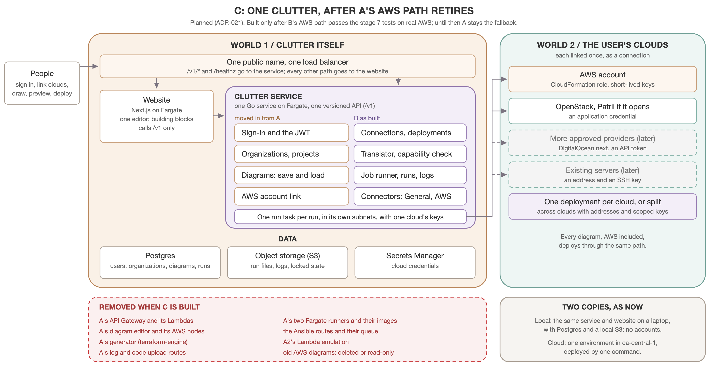

# Implementation plan: from the design to a working B0

The order to build `system-b-adapter-layer.md` in, what each stage changes, how it is tested, and when it is done. The design says what B is and why; this file says how it gets built. Each stage's status is in `.claude/findings/NOW.md` § The order.

## How the work runs

- Each stage passes every check and the smoke test before merge. A stage that touches sign-in, tenancy, credentials or generated code also gets a security review. Findings are resolved before merge.
- The fork's `main` reaches the client's repo by pull request.
- A person deploys; no session does (`environments.md` § The rules).
- **The docs move with the code.** Each stage's pull request updates the owner doc of every fact it changes (`docs/README.md` says which), its row in `.claude/findings/NOW.md`, and the folder README's expected results. A stage is not done while a doc still describes the old state.

## Testing without the client's credentials

Nothing waits for the client except stage 7.

| Fully testable on a laptop | How |
| --- | --- |
| A, except real deploys | A2, the smoke test, Go and frontend tests, `terraform validate` |
| B's API, sign-in, tables, connections, credential encryption | B's Go tests, and smoke checks through A2 |
| The connector contract | a mock connector and the shared contract tests, in CI |
| Real OpenStack deploys | General's OpenStack connector against DevStack |
| B's AWS output | `terraform validate`, the golden test for A's template move, and plan, apply and destroy on LocalStack |
| The whole editor flow | a browser against A2; AWS deployments apply on LocalStack when it runs, and otherwise stop at the AWS call |
| CloudFormation and IAM | `cfn-lint`, `terraform validate` |

Left for the credentials: real AWS deploys by A, hosting world 1 (B on Fargate, S3 state, the website), the client's Google sign-in, and the hosted demo. B's deploys into real AWS and OpenStack accounts, and the role link end to end, can run from a laptop (`backend/devserver/README.md` § Real clouds from this machine).

## Stage 0: housekeeping

Recorded the decisions (ADR-013 to ADR-017), checked the design, and listed the questions for the client (`.claude/findings/NOW.md` § What we need from the client). Done, except the pull request that brings the fork's `main` to the client's repo (NOW.md § The order).

## Stage 1: make A safe

Fixed A's security defects on the paths B shares (the list and what is still open: `.claude/findings/NOW.md` § Open defects in A). Moved A's template loader to `generic/tftemplate` and its JWT check to `generic`, with a golden test that keeps A's output byte-identical. The generator reads the environment's region, and the manual cloud steps are configuration. Done.

## Stage 2: a test cloud on the laptop

DevStack in a Lima virtual machine, as in the research note (`docs/research/openstack/2026-11-13-devstack-and-block-mapping.md`), set up by `npm run devstack`. Done.

## Stage 3: B's core

A new Go module, `backend/adapter`: B API on `/v1`, B's tables (`backend/storage-sql/adapter-tables.sql`), sign-in and tenancy checks, the connector interface with a mock and the shared contract tests, the translator, the capability check, the job runner, the isolated run task (ADR-017), the Terraform runner and the credential store. A2 starts it on `127.0.0.1:8790`, and CI tests it. Done.

## Stage 4: General's OpenStack connector

VM, network, firewall and volume on `terraform-provider-openstack` `~> 3.4` (with `hashicorp/time` `~> 0.14`), verified by a Keystone token request, deployed and destroyed on DevStack through B. Done.

## Stage 5: the AWS connector

A's five templates through `generic/tftemplate`, three new templates (network, firewall, volume), B's own edge-to-IAM step and override files, and the CloudFormation template trusting B's runner role. A CI test renders A's files from disk and runs `terraform validate`. Done.

## Stage 6: the frontend and the whole flow

B's editor for diagrams marked `engine: "blocks"`, the Connections page, and the deploy panel with one row per deployment; A's editor is unchanged. The local demo below runs end to end. Done.

## Stage 7: the cloud

The platform Terraform holds B's part (`backend/infra/modules/adapter-service`): its own VPC, cluster, load balancer, roles, run and state buckets, and the run task each run starts (ADR-017). The go-live steps, every value they need and what success looks like are in `environments.md` § Credentials day, their one owner. **Done when:** the 12-step test in `environments.md` and the demo in `system-b-adapter-layer.md` § What the user sees both pass in the cloud.

| Credentials day, after stages 1 to 6 (`environments.md` § Credentials day) | Time |
| --- | --- |
| Steps 1 to 7: accounts, sign-in, the state bucket, Supabase, the Google client, the site's certificate, the config files | about half a day, most of it console work |
| Steps 8 to 11: plan, the first deploy (which also publishes A's API), DNS, then the images and the website | about two hours |
| Steps 12 and 13: link the test AWS account; start a DevStack VM for demos | under an hour |
| Step 14: run the tests and the demo, and fix what the first real run finds (most likely permissions and settings) | a day, maybe more |

## Stage 8 and later

Patrii as an OpenStack connection when it opens; DigitalOcean as the second General connector; General's existing-servers mode (`general-ssh`) once the config runner is chosen; TierHive when it has an API; the optional Clutter sandbox connection; scoped keys on clouds other than AWS; B1, then B2; retiring A's own AWS flow. Blocks across clouds in one deployment (ADR-020) are already built, pulled forward as stage 6b. Live collaboration is another team's work, on the stable diagram document.

### Retiring A's AWS path

A's AWS-only machinery retires once B has proved itself on real AWS; what B shares with A stays.

1. **B covers what A's AWS path does:** function code upload and server setup at first boot. Both are built (stage 6b in `.claude/findings/NOW.md`).
2. **B's AWS path passes on real AWS from the hosted service:** the stage 7 tests on the test account.
3. **Remove A's AWS machinery in one change:** A's diagram editor and its AWS nodes, generation (`terraform-engine/create`, `files`), the command runner, code upload, A's log routes, the Ansible routes and queue, A's two Fargate runners and their images, and their routes in `backend/infra/main.tf` and A2's route table. Old AWS diagrams (none exist outside test data) are deleted or left read-only; no converter is built unless the client has real ones.
4. **Keep what B uses:** log-in and the JWT, users, organizations, projects, diagram save and load, the CloudFormation account link and A's linked-role table, and the website shell.
5. **Then build C (ADR-021):** move the kept routes into the adapter service under `/v1` and rename its folder for the whole server, point the website at `/v1` only, and delete API Gateway, the remaining Lambdas and A2's Lambda emulation, so Clutter has one backend, one API and one deploy path.

## What runs locally with stages 1 to 6

`npm run dev` starts Postgres, A (through A2), B and the website; DevStack runs in its own VM. In the browser:

1. Sign in.
2. **Connections:** **Connect local AWS** (the fake account, on LocalStack) and **Connect local OpenStack** (this machine's DevStack); both show as verified.
3. **New diagram:** drag in a VM, network, firewall, volume, bucket and function; drop the VM into the network's box, and link the rest with lines. Or start from one of the seven built-in examples.
4. **Deploy panel:** "Amazon Web Services: every block can be built here"; "OpenStack: 2 blocks not supported (Bucket, Function)", which the user leaves out of that deployment.
5. **Preview Terraform** for each deployment.
6. **Deploy to OpenStack:** live status and logs; the VM, network and volume appear in DevStack; **Destroy** removes them.
7. **Deploy to AWS:** valid Terraform is rendered, and the run stops at the AWS call with a clear "needs a real AWS account" message. With LocalStack running (`npm run localstack -- start`), the run applies and destroys on LocalStack instead.
8. Old AWS diagrams open in A's editor and work as before.

From the terminal: `npm run smoke` (A and B, 0 fail), every Go and frontend test, the contract tests and the golden test.
