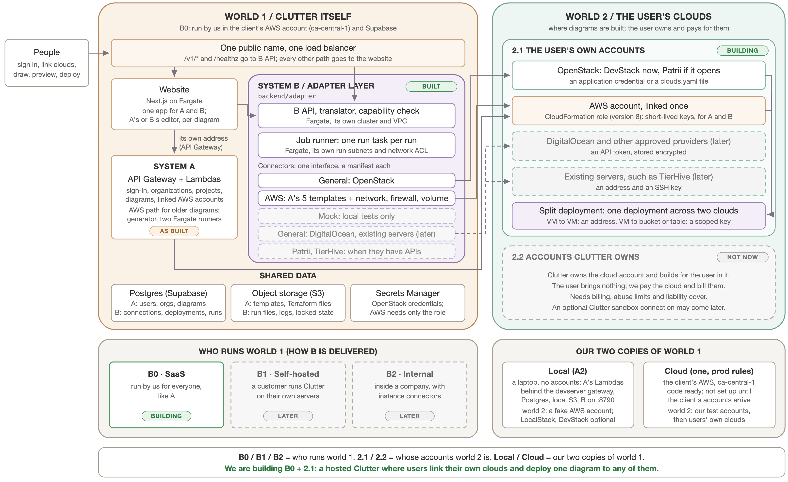

# System B: the adapter layer

This doc is the design. Status: `.claude/findings/NOW.md` § The order. Build order: `implementation-plan.md`. It follows the team's architecture plan (the figures and write-up in `docs/architecture/system-b-team-plan/`). It also follows the product decisions in ADR-013 to ADR-027. Those are B0 with users' own accounts, one diagram with many deployments, AWS as a B connector too, and one deployment split across clouds. Where a part is still later work (B1, B2, Patrii, TierHive, General's existing-servers connector, the sandbox connection), its section says so. The decisions it rests on are in `docs/decisions.md`. What exists today is `system-a-as-built.md`. The Patrii facts are in `docs/research/patricloud/2026-10-26-patricloud-research.md`.

## The goal

Expand the Clutter codebase so a diagram can deploy to targets other than AWS. General comes first (one connector per approved Terraform provider, OpenStack first). Then come AWS as a B connector, PatriCloud (our working name for Patrii Cloud), TierHive and whatever comes later. There is one standard way for Clutter to talk to any target (the **connector interface**), and one **connector** per target. The people who come after us add connectors without reworking what exists.

**The problem.** People want to describe infrastructure as a picture and have it built for real in their own cloud, without writing Terraform. A does that for AWS only, and AWS is wired through its core: the generator, the canvas, the account link and the deployer. Adding one more cloud to A means rewriting all four.

**The value of the adapter layer.** The core (canvas, translator, capability check, job runner) is written once, and each target is one connector. A new target costs a connector, not a rewrite. For users: one diagram builds on AWS, on Canadian clouds such as Patrii, on cheap VPS hosts, or on the approved Terraform providers. For customers who will not hand their cloud keys to an outside service: they can run Clutter themselves (B1). For later teams: they add targets without touching what works.

**The product, as a user sees it.** Clutter is one hosted product, in the way Brainboard is. A user signs in and links the clouds they already have (an AWS account, an OpenStack project, a hosting provider, their own servers). They draw one diagram and deploy it to any of those clouds, or to several. They never see A, B or a connector; they see one editor, one Connections page and one deploy panel.

The layer has two faces:

- **Outbound:** connectors behind one interface. Adding a target means writing a connector, not editing the core.
- **Inbound:** B's own API, versioned. Clutter's UI calls it, and people and other products can call it to use Clutter without learning React Flow, Supabase webhooks or AWS role ARNs.

Clutter owns intent (what the customer wants); targets own resources. Callers talk to Clutter; Clutter talks to targets. A target such as Patrii is not a host for the standard and not a caller. It publishes no inbound plugin and has no diagram, plan or apply resource. A target-side integration that only wants inventory (as Patrii's Lynx DCIM connector sketches) is a read through the same connector.

## Names

This table owns the names. Other docs use them and point here.

| Name | Means |
| --- | --- |
| **C** | the whole Clutter app. Today it is A + A2 + B; after A's AWS path retires (ADR-021) it is one service and one website |
| **A** | Clutter as it exists today: the AWS system, complete and tested (`system-a-as-built.md`). It keeps serving existing AWS diagrams. |
| **A2** | the local extension (`backend/devserver`): it runs A without AWS, and runs B beside it on a laptop. It wraps A and does not change it, except the local-only Link fake account button (ADR-011). For the team, not for users. |
| **B** | the adapter layer, built beside A (Option 1, ADR-006). Its code is in `backend/adapter`, and its API is B API. "B" is the team's shorthand in plans and docs; paths, settings (`ADAPTER_*`) and code say "adapter". |
| **world 1** | Clutter itself: website, APIs, database, object storage, secret store and runners, in an account Clutter's operator controls |
| **world 2** | the cloud accounts where users' diagrams are built. World 1 never builds a user's resources inside itself. |
| **2.1** | world 2 is the user's own cloud accounts, which they link to Clutter. **Chosen (ADR-013).** |
| **2.2** | world 2 is cloud accounts Clutter owns and resells. **Not now** (ADR-013); an optional Clutter sandbox connection may come later. |
| **B0** | B run by us as a hosted service (SaaS), so we run world 1. Built first. |
| **B1** | B shipped as a self-hosted service people run on their own servers, so they run world 1. Its connectors are entity connectors. Later. |
| **B2** | B run inside a company's own setup, with instance connectors. Later; whether to do it at all is a separate decision (ADR-007). |
| **connector** (**X1 … Xn**, or **1 … n** in the figures) | the code for one kind of cloud, behind one interface: General's connectors (§ General) and AWS. Later, Patrii and TierHive, through General where they offer a standard provider |
| **General** | the team's name for a family of connectors: one per approved Terraform provider (OpenStack first, DigitalOcean next), plus existing servers over SSH (later). Users never see the word; they pick a cloud by name. |
| **entity connector** | a connector for a kind of cloud, written once by us (B0 and B1) |
| **instance connector** | a connector a company builds or configures for its own setup (B2) |
| **connection** (**I1 … In** in the figures) | one organization's linked cloud account: a connector plus credentials and region. Older docs and figures call it an instance. |
| **building blocks** (**a … n** in the figures) | the standard features every connector maps onto: VM, network, firewall, volume, bucket, function, table, HTTP API. Their portable fields are owned once, in `backend/adapter/connectors/blocks.go`, so one diagram passes every connector. A cloud-specific choice (an image, an instance type) is a deployment setting |
| **target** | a kind of cloud Clutter can build in (AWS, OpenStack, Patrii). Each target has one connector; screens say "cloud" |
| **project**, **diagram** | as in A: a project holds diagrams. A diagram drawn in building blocks is marked `engine: "blocks"`. |
| **edge** | a line between two blocks of a diagram, such as "this VM reads this bucket". Each connector turns it into its own wiring. The capstone's report calls an edge a connection, which is not a **connection** below |
| **run** | one plan, apply or destroy of one deployment, with its status and log. A's Terraform runs are rows in `diagram_deployment_logs` |
| **deployment** | one diagram bound to one connection, with its own settings, exclusions, Terraform state and run history. A diagram can have several. A deployment can place some of its blocks on other connections of the same organization (§ Split deployments). |
| **placement**, **part** | a placement puts some of a deployment's blocks on another of the organization's connections, with that cloud's own settings. Each cloud of a split deployment is one part, with its own Terraform state |
| **cross-cloud edge** | an edge whose two blocks sit on different clouds of one deployment: an address edge or a permission edge (§ Split deployments) |
| **scoped key** | a key Clutter creates in a target's cloud for one permission edge, which can only read that one bucket or table |
| **workspace** | not in the first build: a second environment of the same diagram is a second deployment |
| **seam** | one of the places B touches A (§ The seams: where B touches A even in Option 1) |
| **phase 0** | the security fixes on paths A and B share; part of stage 1 (`implementation-plan.md` § Stage 1) |
| **stage** | one step of the build order, 0 to 8 (`implementation-plan.md`) |
| **local**, **cloud** | our two copies of world 1: a laptop with no accounts, and one cloud environment in `ca-central-1` (ADR-015, `environments.md`) |
| **PatriCloud** | our working name for Patrii Cloud (patrii.cloud), a Canadian cloud; the same thing |

A cloud's own word for its tenant (Patrii and OpenStack call it a project) is never used for a Clutter object in B's code. It is a connector-side field such as `patrii_project_id`.

## Four separate questions

Most confusion about B comes from mixing four questions that have separate answers.

| Question | Choices | Chosen |
| --- | --- | --- |
| Who runs Clutter itself (world 1)? | B0 us, as SaaS · B1 the customer, self-hosted · B2 a company, internally | **B0** (ADR-007) |
| Whose cloud does a diagram build in (world 2)? | 2.1 the user's own accounts · 2.2 accounts Clutter owns and resells | **2.1** (ADR-013) |
| How is B's code related to A's? | Option 1 beside A · Option 2 reuse parts of A · Option 3 turn A into a connector | **Option 1**, reusing A's sign-in, database and templates (ADR-006, ADR-014) |
| Which copy of world 1 is it? | local · cloud | **local and one cloud**, run with prod rules (ADR-015) |

B1 is not 2.2. B1 means a customer runs Clutter on their own servers and builds in their own clouds. 2.2 means Clutter owns the clouds users build in. The user never sees any of these choices.



## Level 1: how B attaches to A

| Option | What it is | Status |
| --- | --- | --- |
| 1. Build B next to A | A stays as it is. B is a new, separate part of the same app, backend services and frontend screens, with its own tests. Connectors plug into B. | **Main priority** (ADR-006) |
| 2. B reuses parts of A | Same structure, but B calls existing A code instead of copying it. `backend/api/generic` (responses, Postgres access, the membership check) and the JWT sign-in are the candidates. | Fallback |
| 3. Turn A into the adapter | Edit A, strip its AWS-only parts, split the Terraform engine, migrate the database. AWS becomes one more connector. | Avoid as a starting move; reachable later, piece by piece |

Why Option 1: A is a working application, and every change to it means retesting every AWS path. Leaving A alone keeps that work safe, and puts all new work and tests in B.

The trade-off of Option 2: once B depends on parts of A, a change there can break B. A shared piece needs its own tests before B calls it.

### The seams: where B touches A even in Option 1

These are unavoidable and named here so that Option 1 does not drift into Option 2 without a decision:

1. **The UI.** A Connections page for every cloud, a palette and forms read from connector manifests, and a deploy panel that lists the diagram's deployments. Existing AWS diagrams keep A's screens and calls; new diagrams call B.
2. **Shared sign-in and the JWT authorizer.** Users sign in once. B verifies A's JWT.
3. **The shared database.** Orgs, projects and diagrams stay A's tables. B adds tables for connections, credential references, deployments and runs. B reads A's linked AWS roles as AWS connections, so a user links an AWS account once.
4. **A's security defects.** B inherits A's sign-in, its database and its membership check, so the defects in `.claude/findings/NOW.md` that sit on those paths are B's defects too. Fixing them is the main change to A's behaviour this plan requires (phase 0). Stage 1 also puts A's template loader and JWT check in `generic`, and makes the generator read the environment's region. It also replaces the Supabase webhook with an authenticated save-then-generate step. The open generation endpoint and the database's row-level security are the two defects that touch shared paths directly (`system-a-as-built.md` § What changed since the capstone).

Any other change to A is a decision, recorded in `docs/decisions.md` before it is made.

## Level 2: inside B

### B0, B1 or B2

The same B can be delivered three ways. They differ in who runs world 1 (§ Names) and so who holds the users' cloud credentials.

| | B0: SaaS | B1: self-hosted | B2: internal |
| --- | --- | --- | --- |
| World 1 runs | in our cloud, run by us | on the customer's own servers, run by them | inside a company, run by them |
| World 2 builds in | the users' clouds | the customer's clouds | the company's private systems |
| Postgres | ours | theirs (any Postgres) | theirs |
| Object storage | ours | theirs (any S3-compatible: MinIO, Ceph, Patrii's S3) | theirs |
| Secret store and cloud credentials | held by us | held by them | held by them |
| Connectors | ours | ours | ours, plus instance connectors the company writes |
| Good for | most users | companies that will not hand their keys to an outside service | companies with in-house clouds |

Order: B0 first, B1 when a customer asks for it, B2 only with a partner who supplies the details. For B1 and B2 to stay possible, B never assumes AWS S3 or Supabase. It takes any Postgres and any S3-compatible store from day one. A has Supabase-only parts (the `anon` role) that B does not copy. A2's local S3 already shows the S3 code working against a store that is not AWS.

### Standard features, connectors and connections

Each connector declares, per standard feature, how it treats it. This is the capability manifest (ADR-001).

| Treatment | Meaning | Example (an Acme TierHive connection) |
| --- | --- | --- |
| as-is | the feature maps straight across | a: compute VM, b: bucket |
| extended | the feature exists, with more for this connector or connection | c: config runner plus a custom image |
| removed | the feature does not apply | d: no serverless functions |
| new | something only this target or connection has | e: GPU node |

Shared behaviour lives in the standard features. Differences live in the connector or the connection, never in the standard set. The UI hides what a target cannot do instead of failing at deploy time.

The first building blocks, and what each first connector maps them to:

| Building block | AWS connector | OpenStack connector (General) |
| --- | --- | --- |
| VM | EC2 instance (A's template; its AMI is fixed to Amazon Linux 2023 on x86, so image choice is new work). Its startup script is the instance's `user_data_base64`, set in B's override file. `user_data_replace_on_change` makes a changed script build a new instance | Nova server. With `public`, a floating IP is associated to the server's port (`openstack_networking_floatingip_v2` and `_associate_v2`; provider 3.x has no compute association), 30 seconds after the server is created (a `time_sleep`), because an OVN cloud (VEXXHOST, for example) never routes an address associated while the port is still coming up. The image is a deployment setting, matched by name prefix. Its startup script is the server's `user_data` (a change builds a new server) |
| Network and subnet | new template: VPC split into a private and a public subnet, an internet gateway and route table for public VMs, and a NAT gateway for private VMs when the block's "Internet access for private servers" is on | Neutron network and subnet. With "Internet access for private servers" on, it joins the deployment's one router, whose gateway is the cloud's external network (a connection setting); off, it joins none, so it has no floating IPs either |
| Firewall rules | new template: security group (A's EC2 template has none) | security group and rules |
| Block volume | new template: EBS volume and attachment | Cinder volume and attachment |
| Bucket | S3 bucket (A's template) | removed (Swift later) |
| Function | Lambda (A's template). Its code is the zip uploaded through B for that block, or, when there is none, Clutter's sample code, which answers every request with a small JSON message (`backend/adapter/README.md` § Function code). Its handler is the block's `handler` field or the runtime's default (see § AWS) | removed |
| Key-value table | DynamoDB (A's template) | removed |
| HTTP API | API Gateway REST API (A's template, which has no Lambda integration). B's own files add the routes and integrations for each HTTP API to function edge | removed |
| Server setup | the VM's startup script, run by cloud-init at first boot (it replaces A's Ansible over SSM for B) | the VM's startup script, run by cloud-init at first boot |

The new AWS templates are B's work in stage 5; A never had them.

Principles carried from the first design:

1. **Capability-based, not lowest common denominator.** A common-denominator model would remove Lambda, API Gateway and DynamoDB from every user to make room for a target that lacks them. A diagram may use any block; a target that lacks one says so before anything runs.
2. **Building blocks first, target-only extras allowed.** A node is a building block ("VM") with common fields (name, size, image) and per-target settings (an AWS instance type, an OpenStack flavor). A target-only node (marked "new" in its manifest, such as a GPU flavor) is allowed, but it limits which targets the diagram can deploy to. This replaces "target-native nodes first" (ADR-014).
3. **One owner per resource definition.** The connector's manifest, in Go, is the single source. B's catalog route, palette and config panel read it; nothing is maintained beside it. (A's five-place drift is not repeated in B.)
4. **B's core never names a connector.** It asks the registry for the deployment's connector and calls the interface. A `switch target` in the core is a defect.
5. **Credentials are the connector's shape, stored B's way.** Each connector declares its credential schema and how to verify it. B stores a reference to an encrypted secret, never the secret in a plain column, and never logs it.
6. **State lives with the target where it allows it.** For Patrii, Terraform state for a customer's deployment belongs in that customer's object storage, with locking, not in Clutter's shared bucket. Where the target has no storage that supports locking, state stays in Clutter's storage, encrypted and locked, keyed by deployment id.

### One diagram, many deployments

A diagram is drawn once. Each place it runs is a **deployment**: the diagram, one connection, that connection's settings, and its own Terraform state and runs (ADR-014).

- **Deploying to several clouds** means deploying each deployment. Each is an independent run; one failing does not undo another. One system spread over several clouds is one deployment with blocks placed on other clouds (§ Split deployments). Its run does undo a failed first build.
- **The deploy panel shows a compatibility line per connection,** computed by the capability check: "Amazon Web Services: every block can be built here", "OpenStack: 1 block not supported (Function)". The user either removes the block from the diagram or **leaves it out of that deployment only** (a per-deployment exclusion, shown on the line). A deployment cannot start while an unsupported block is still included.
- **Settings that differ per cloud** live on the deployment, not on the diagram: instance type on AWS, flavor and image on OpenStack, region on both.
- **Edges** between blocks mean the same everywhere they can: a VM attached to a network, a volume to a VM, a function allowed to read a bucket. Each connector turns an edge into its own wiring (an IAM policy on AWS, an attachment on OpenStack). An edge a target cannot express is reported like an unsupported block. An edge to an excluded block is dropped from that deployment with a note.
- **Names and renames.** Inside the generated Terraform, each block is addressed by its node id, not its name, so renaming a block does not destroy and re-create it. Every cloud-side name (resource names, IAM role names) carries a short deployment prefix. So two deployments, or A and B, can share one cloud account without colliding.
- **What a run deploys.** Each run records the diagram history version it was built from. So the run history says exactly what was deployed, and a later edit does not change what an earlier run claims.
- **Deleting.** A connection with live deployments cannot be deleted until those deployments are destroyed. The same holds for a diagram, project or organization with live deployments: a database trigger refuses removing a live deployment by a cascade. Deleting a connection marks it as being deleted first, then deletes its secret, then its row, which removes its deployments that hold nothing. A delete that stops partway leaves the mark and the secret reference, so it can be finished later. No clean-up job for such leftovers, or for a removed deployment's state, exists yet (`.claude/findings/NOW.md` § The order, stage 3).
- **Tenancy.** Every deployment action checks three things before anything runs. The caller is a member of the organization, the diagram belongs to that organization, and the connection belongs to the same organization.
- **A diagram is A's or B's.** A building-block diagram carries a marker in its saved document (`engine: "blocks"`). A's generation step skips such diagrams, and A's editor never opens them. Diagrams without the marker are A's, unchanged.

#### Split deployments

One deployment can place each block on a different linked cloud of the same organization, with no manual step in the middle (ADR-020). The plan is `backend/adapter/internal/split`, the run is in `backend/adapter/internal/jobs`, and the contract is `connectors.CrossCloud`.

**Placement.**

- A deployment keeps its own connection (the primary) and may have placements. Each placement names another connection of the organization, the blocks (node ids) on it, and that cloud's own settings (`deployment_placements` in `adapter-tables.sql`). Every block not placed runs on the primary.
- When B writes a placement row, it proves the placement's connection belongs to the deployment's organization. The insert selects the connection by id and organization. So another organization's connection is "not found", on create and on PATCH alike.
- A block is placed on one cloud at most, a placement holds at least one block, and a deployment has at most eight placements.
- Blocks move between clouds only while the deployment holds nothing (new or destroyed). Moving a block of a live deployment would leave its old cloud's state without it, so B answers 409 `deployment_live`. A placed cloud's settings may change while live, as the primary's may.
- A connection that a live deployment places blocks on cannot be deleted, just as its primary cannot. A database trigger refuses removing such a placement by a cascade.

Each cloud of the deployment is a **part**. A part's Terraform state is keyed by the deployment and the connection. The primary keeps the deployment's own id, so a deployment's state stays where it was before any block was placed. Every other part gets a fixed id derived from the deployment and the connection (`split.PartID`). Every part shares the deployment's name prefix. A part's graph is the whole diagram with every block of the other parts left out. So the capability check runs per block against its own cloud's manifest. The deployment's own exclusions still apply. Before a run, every part's connection is verified, and every part passes the capability check, its connector's `Validate` and its `CrossCheck`.

**Cross-cloud edges.** An edge whose two blocks sit on different parts is one of two classes, owned once in `connectors.CrossClass`. Only a VM is a source across clouds, because only a VM takes values at first boot (cloud-init).

| Edge across clouds | Class | What crosses | The target's cloud |
| --- | --- | --- | --- |
| VM to VM ("the VM gets the other VM's address") | address | the target's public address | the target VM must be public |
| VM to bucket ("the VM can read the bucket") | permission | the bucket's name and region, and a scoped key's id and secret | creates the scoped key (AWS today) |
| VM to table ("the VM can read the table") | permission | the table's name and region, and a scoped key's id and secret | creates the scoped key (AWS today) |
| VM to network, volume to VM, firewall to VM | refused | | one cloud's wiring: "place both on the same cloud" |
| function to bucket or table, HTTP API to function | refused | | wired inside one cloud's IAM: "place both on the same cloud, or connect a VM instead" |

The same edges inside one cloud:

- A VM to a VM hands the source the target's private address.
- On AWS, a VM to a bucket or table attaches the reads to the instance's role and hands it the name and region, with no key.

How values reach a VM:

- They arrive as a small `/bin/sh` wrapper in its user data. The wrapper writes them to `/etc/clutter/connections.env` (readable by root only), one `CLUTTER_<BLOCK>_<VALUE>` line each (for example `CLUTTER_FILES_BUCKET`, `CLUTTER_FILES_SECRET_ACCESS_KEY`, `CLUTTER_DB_ADDRESS`).
- The wrapper exports them and then runs the block's own startup script. That script still reaches the Terraform only as base64 (`connectors.StartupHCL`).
- A value from another cloud must match a narrow alphabet (an address, a name, a region, a key) before any other cloud sees it. So it cannot break out of the shell's single quotes or the HCL string.
- With values, the startup script can be about 11 KB, so the whole fits AWS's 16 KB of user data.

Firewalls and circles:

- Clutter opens no firewall rule for a cross-cloud edge. A VM's outbound traffic is open on both clouds already.
- An inbound rule on the target would need the source's address before the source exists, which the order below forbids. The target's own firewall blocks decide who reaches it.
- Two kinds of circle are refused: VMs on one cloud that get each other's address in a circle, and clouds that hand each other values in a circle. In both, nothing could be built first.

**Scoped keys (permission edges).** On AWS, the AWS part creates three things for each permission edge (the AWS connector's `cross.tf.tmpl`):

- **One IAM user** under `/clutter/`, named after the deployment's prefix and the edge (`<prefix>-x<10 hex>`). The user carries the stack's users' boundary (reads only on buckets and tables whose names start with a deployment prefix, nothing in IAM) and the tag `ManagedBy = Clutter`.
- **One inline policy** that allows only the edge's reads. For a bucket, those are `s3:ListBucket` on the bucket and `s3:GetObject` on its objects. For a table, they are the six DynamoDB reads on the table and its indexes.
- **One access key.**

How the key's secret is kept out of sight:

- The secret is a sensitive Terraform output. B reads it with `terraform output -json`. That output goes to its own object (`runs/<run>/out/outputs.json`) and never into the run's log.
- The job runner adds the secret to the values it removes from the log.
- The next part renders it only inside the source VM's user data, which is then `sensitive(...)`, so Terraform prints neither.
- It is never in a preview (a preview renders a placeholder for every value another cloud hands a VM), a response, a `Problem` or a log.
- Destroying the deployment deletes the key, the policy and the user.

What the customer role allows for scoped keys (`RoleTemplateVersion` 10):

- Exactly the calls the AWS provider (5.x, matched against v5.100) makes for these three resources without `force_destroy`, and only on `user/clutter/*`.
- `CreateUser` only with the users' boundary and Clutter's tags. `PutUserPolicy` only on a user with that boundary. `CreateAccessKey` only on a user tagged `ManagedBy = Clutter`.
- Also `GetUser`, `DeleteUser`, `TagUser`, `UntagUser`, `ListGroupsForUser`, `GetUserPolicy`, `DeleteUserPolicy`, `ListAccessKeys` and `DeleteAccessKey`.
- Removing a user's boundary is denied.

This is ADR-020's accepted trade-off. A long-lived key sits inside the user's VM for the deployment's life:

- It is in the VM's user data (which anyone on the VM can read from the instance metadata) and in `/etc/clutter/connections.env`.
- A stolen key reaches only what the edge allowed. From anywhere on the internet, it can list and read the objects of that one bucket, or read the items of that one table, until the deployment is destroyed.
- It cannot write. It cannot reach any other bucket or table: its policy names one, and its boundary allows only Clutter's deployment-named ones.
- It cannot do anything in IAM (the boundary denies it), so it cannot make itself another key.
- The key's secret also sits in the AWS part's Terraform state (encrypted, in Clutter's state bucket). When the source VM is on AWS too, the secret also sits in that part's state as user data.
- This would change if a cloud offers workload identity across clouds (IAM Roles Anywhere with a certificate Clutter issues). That would replace the key with short-lived credentials.
- Pinning the key to the source VM's address (`aws:SourceIp`) is not possible: the target's cloud is built before the source VM has an address.

**Order and roll-back.**

- One run takes the parts in dependency order. A part whose blocks another part's VMs need is applied first. Its outputs (read with `terraform output -json`) go into the next part's render.
- Each part runs as its own step, with its own run id, in its own isolated run task, with only its own cloud's credentials. The job runner asks the broker for one part's credentials just before that part's step. No step's environment ever holds two clouds' credentials.
- If a part's apply fails and the deployment held nothing before the run (new or destroyed), the run destroys what this run built. It goes newest first and includes the failed part's partial build. The deployment keeps its status from before the run. The run's failure names the cloud that failed and says the rest was rolled back.
- If the roll-back of a cloud fails too, the deployment is failed and the failure names both.
- A live deployment is not rolled back, because destroying would remove what ran before the run. Instead the deployment is failed, and the failure says the clouds before it were updated.
- A destroy takes the parts in reverse order and destroys every part even when one fails.
- A plan takes the parts in order too, and hands on the values each part's state already holds (a placeholder before the first apply).
- Each run records where every cloud stands (`runs.parts`), so the deploy panel shows run progress per cloud.

**The connector side.** A connector takes part in a split by implementing `connectors.CrossCloud` (§ The connector interface). A connector without it cannot be any cloud of a split deployment, and the capability check says so. AWS and General's OpenStack connector implement it. AWS exports a public VM's address and scoped keys for buckets and tables. OpenStack exports a public VM's floating address. Both take every value into their VMs. The mock connector implements it for tests. The contract tests run a split plan, apply and destroy over two clouds of each connector through the real job runner. They also check that a preview never holds a value another cloud hands a VM.

## Level 3: how B works

### Parts

| Part | Job |
| --- | --- |
| B API | B's own Go service and routes; the inbound standard (below) |
| Translator | turns the stored diagram into a neutral graph not tied to AWS |
| Capability check | compares the graph with the chosen connector's manifest and flags unsupported pieces before anything runs |
| Job runner | queues the job, tracks status and logs, as A does today |
| Connector interface | the one contract every connector implements |
| Connectors 1 … n | General's (OpenStack first, then more approved providers, then existing servers over SSH), AWS, and future targets (§ General) |
| Shared Postgres and S3 | A's orgs, projects and diagrams, plus B's connection, credential reference, deployment and run tables |

### One deploy through B

1. The user clicks Deploy on one or more of the diagram's deployments (for example Acme's OpenStack).
2. B API sends the diagram to the translator.
3. The translator builds the neutral graph and runs the capability check.
4. The result comes back: OK, or the unsupported pieces.
5. B API queues the job (status QUEUED).
6. The job runner checks the run first: the connection's credentials, the connection itself, the capability check and the connector's own rules.
7. The connector renders the deployment's Terraform and hands it to the shared Terraform runner, which refuses dangerous Terraform before it plans.
8. The runner starts a run task for the run: a child process on a laptop, a short-lived Fargate task in the cloud. The task runs `terraform plan` and `apply` against the target, with the deployment's state behind a lock (on disk locally, in S3 in the cloud).
9. The target creates the VM, bucket and so on. The run task writes the log (secrets redacted) and the outputs. The job runner records the run and the deployment's status (COMPLETED, and the deployment live).
10. The UI polls B for the run's status and log every 2 seconds while it is queued or running.

### The connector interface

The plan's contract is validate, plan, apply, destroy and logs. B's code owns the interface (`backend/adapter/connectors`); in short:

```go
// Package connectors. Each target implements Connector and registers itself.
type Connector interface {
    ID() string                                            // "general-openstack", "aws", later "general-digitalocean", "general-ssh"
    Manifest() Manifest                                    // blocks (as-is, extended, removed, new), fields, defaults, allowed values, regions, display names and icon keys
    Credentials() CredentialSpec                           // what a connection supplies, and how the UI asks for it
    VerifyConnection(ctx context.Context, c Connection) error // proves a connection's credentials work before it is saved, and again before each run
    Validate(g Graph, d Deployment) []Problem              // the cloud's own rules before anything runs (ranges, limits, wiring, names); honours exclusions. The core runs the capability check beside it (capability.CheckConnector), so Validate never repeats it
    Plan(ctx context.Context, run Run, g Graph, d Deployment) (PlanResult, error)
    Apply(ctx context.Context, run Run, g Graph, d Deployment) (RunResult, error)
    Destroy(ctx context.Context, run Run, d Deployment) (RunResult, error)
}
```

Three more interfaces are optional. The core finds each by type assertion and never by the connector's id:

```go
type Previewer interface {    // the deploy panel's Terraform preview, rendered without credentials
    Preview(ctx context.Context, g Graph, d Deployment) (map[string][]byte, error)
}
type Linker interface {       // accounts the organization linked outside B (AWS's CloudFormation roles)
    Linked(ctx context.Context, orgID string) ([]LinkedAccount, error)
    LinkedSecrets(ctx context.Context, orgID, linkedID string) (LinkedCredentials, error)
}
type OptionLister interface { // the values the user's cloud offers for each deployment setting
    Options(ctx context.Context, c Connection) (Options, error) // Options{Settings map[string][]Choice, Suggested map[string]string}, Choice{Value, Label}
}
```

A fourth optional interface lets a connector's clouds be parts of a split deployment (§ Split deployments). Each method reads the part's cross-cloud edges from `Deployment.Cross`. Its exports are edges whose target is on this part. Its imports are edges whose source VM is on this part, with the values the earlier parts returned. `Validate` and `Preview` read it too.

```go
type CrossCloud interface {   // a cloud that can be one part of a split deployment
    CrossCheck(g Graph, d Deployment) []Problem                                    // exports or imports this cloud cannot serve
    PlanCross(ctx context.Context, run Run, g Graph, d Deployment) (PlanResult, Outputs, error)  // outputs: what the part's state holds
    ApplyCross(ctx context.Context, run Run, g Graph, d Deployment) (RunResult, Outputs, error)  // outputs: every export's values
}
```

`OptionLister` lets a setting that names something in the user's cloud (an image, a flavor, an external network) be a list of that cloud's own values. It is handed the connection's credentials for one call, like `VerifyConnection`, and returns names only. The core keeps only settings the manifest declares and values the manifest accepts, and a typed value is still allowed. General's OpenStack connector implements it with one Keystone token and the Nova, Glance and Neutron list calls, cached per connection for 10 minutes.

A `Run` carries the run's id, its action and a log writer. The job runner's log store is the one owner of run logs, so a connector writes to the run's writer and keeps nothing after the run. Logs are not a connector method. A `Deployment` carries everything one run needs: its id (which keys the state and the name prefix), its connection, its per-deployment settings and exclusions, and its state backend.

A building-block diagram is a diagram document with `engine: "blocks"`. Each node's `type` is its block kind, `data.name` its name and `data.fields` its fields. The translator in `backend/adapter/internal/translate` owns that shape. Block names pass the same name check as A's resources (`generic/hclsafe`).

A workspace (an environment inside a connection) is not in the first build; a second environment of the same diagram is a second deployment.

How a connector does plan and apply is its own business, but most should share one way (ADR-002). They render HCL for an existing Terraform provider and hand it to a shared Terraform runner that holds state with a lock. Plan, apply, state and drift then stay in Terraform, as in Terraform's own core and provider split. Clutter does not create resources through cloud APIs itself. A connector calls a target's API directly only when that target has no Terraform provider and no standard API (see Patrii Path C). Server setup is cloud-init at first boot on every cloud. A VM block's `startup_script` reaches the server as user data (AWS and OpenStack alike), so B needs no SSH or SSM into users' servers. A's Ansible over SSM stays only for A's own diagrams until A retires.

### Isolating the runner

The runner holds the keys to a user's cloud. So it is built so that a mistake or a hostile diagram reaches only that one run's cloud (ADR-017):

- **One task per run.** Each run starts its own short-lived container with no database access and no secret-store access. A broker in B's API fetches that run's credentials and hands in only those: short-lived session keys for AWS, the one connection's token for others. A's runners, by contrast, share one task role that can assume every customer's role (an open defect in `.claude/findings/NOW.md` § Open defects in A). They do not hold the database string.
- **Only Clutter writes the Terraform.** B renders HCL from building blocks with its own templates; no user-written HCL reaches the runner. General supports only providers on an allow-list that Clutter maintains, not any provider a user names.
- **Dangerous features are refused.** Rendered Terraform may not contain provisioners or the `external` and `http` data sources. The runner checks this before `plan`. `TF_LOG` is never set, so provider debug output cannot leak credentials into logs.
- **Its own cluster.** B's run tasks do not share a cluster with A's, so A's `logs/live` cannot read them.
- **No way into Clutter's network.** Run tasks sit in their own subnets. Their network ACL refuses every private, shared and link-local address, B's own VPC included. So a cloud address a user gave cannot lead a run to B's API, its load balancer or anything else inside. Such an address is an OpenStack auth URL, or an endpoint its catalog lists. Before Terraform starts, the run task also resolves each address the connector names as public (the OpenStack auth URL's host). It stops the run if one resolves to a refused address. That check holds only at the moment of the lookup. A name whose DNS changes during the run is stopped by the network ACL. An ACL cannot filter the VPC's DNS resolver or the ECS task metadata address, which holds no credential: a run task has no role.
- **One task per cloud.** Each cloud of a split deployment runs as its own step, in its own task, with only that cloud's credentials. A part's Terraform outputs, which may hold a scoped key, come back from the task as their own object, never in the log.

What each part replaces in A, for the day AWS moves into B (Option 3, later):

| B part | Replaces in A |
| --- | --- |
| `Manifest` | the type constants, the label switch, the seed rows, the palette list and the config panel option lists |
| `Validate` | per-generator `ValidateVariables`, plus the input validation that is missing today |
| plan and apply through the Terraform runner | the generator files, the template prefix, IAM from edges, the fixed `provider "aws"` block |
| `Credentials`, `VerifyConnection` | the CloudFormation link and role-ARN handlers, which store the ARN unverified |
| connection credentials into the runner | the role ARN and external id passed to the deployer, and the STS step in its script |
| the runner's state backend | the local state file synced to S3 without a lock |
| the region list in the manifest | the region list in `generic`, the schema enum and the frontend's own list |

## The inbound standard: B API

### Principles

1. **Clutter's model is the contract.** Callers send intent; connectors turn it into each target's resources. A caller never sends an ARN, a Terraform block or a target's API path as the standard's vocabulary.
2. **Every caller resolves to a member.** A service credential is a new way to mint an identity that still passes the one membership check (`CheckOrganizationMembershipPSQL`), never a bypass of it. Google sign-in stays one client of the same rule.
3. **Compile and run are one authenticated sequence.** A public webhook that compiles, and a diagram save that does not (as in A), cannot be the contract.
4. **B API is the only versioned surface.** `/v1`, one error envelope, one id style, an idempotency key on every create. Neither A nor Patrii has idempotency today, and Patrii's own changelog records a retried create starting duplicate billable servers.
5. **One naming rule for every `/v1` route.** Paths use plural nouns. Ids go in the path, nested under their owner (`/v1/organizations/{org}/diagrams/{diagram}/deployments`). Paths hold no verbs except real actions (`.../verify`, a `POST` that starts a run). JSON and query strings use `snake_case`. Times are RFC 3339. There is one error shape, `{"error":{"code","message","problems"?}}`. A new major version comes only for a breaking change. A's own routes keep their shapes until they move into the adapter service (ADR-021) and are not a model for new routes.
6. **A's trust boundary is not standardized.** The admin-sized customer role and the open compiler are fixed before any other product is invited in (stage 1; the role: ADR-027).

### The objects

| Object | What it is | In A today |
| --- | --- | --- |
| Organization | the tenant | organization CRUD; the creator is the only member; no invite route (the members page shows only the signed-in member) |
| Project | holds diagrams | project CRUD; name column 32 characters while the API schema allows 100 |
| Desired state | the diagram, as a neutral graph the standard translates to and from the canvas document | diagram CRUD; save does not compile |
| Deployment | one diagram bound to one connection, with its settings, exclusions, placements on other connections, state per cloud and runs | none: a diagram has one implicit AWS deployment |
| Target | a connector type (X), with its manifest | none: AWS is implicit |
| Connection | one organization's configured setup of a target (I1 … In in the figures), with a credential reference and region | the AWS-named role table and its two-step CloudFormation link |
| Run | validate, plan, apply or destroy of one deployment; one resource to poll, events to subscribe to | Terraform runs in `diagram_deployment_logs`, Ansible in `jobs`: two tables, polled logs, no events |
| Catalog | the features a target accepts, read from its manifest | the seed table, the generator switch and the config panel: three lists that drift |

Not in the standard until a handler exists: member invites and roles, token refresh and revoke, and diagram history (A writes it, never exposes it).

### Connecting a target

To build in a user's cloud, Clutter needs that user's permission. A connector's `Credentials` method says what to ask for, and `VerifyConnection` proves it works before anything is saved. There are two kinds:

- **Borrowed access**, the kind A uses for AWS. The user creates a role or identity in their cloud that trusts Clutter. Clutter asks the cloud for short-lived keys at each run. Nothing permanent is stored; the user revokes access by deleting the role.
- **A stored token or key**, when the cloud offers nothing else: Clutter must keep it.

| Target | The user supplies | Kind |
| --- | --- | --- |
| AWS | a role, through a CloudFormation link (as in A) | borrowed, short-lived |
| Azure, Google Cloud | an identity that trusts Clutter (workload identity federation) | borrowed, short-lived |
| OpenStack, including Patrii if it opens its endpoints | an application credential with an expiry and access rules | scoped token |
| DigitalOcean, TierHive's future API, most hosts | an API token | stored token |
| Existing servers (General's existing-servers connector, later) | an address and an SSH key | stored key |

Rules: prefer borrowed access wherever the target supports it. A stored token goes into a secret store, encrypted, and Postgres keeps only a reference to it. The token reaches the runner for one run only and never reaches a log, a response or a doc. Clutter never asks for a cloud password (ADR-016).

Where a stored token lives: in B0, AWS Secrets Manager in Clutter's account, one secret per connection. Locally, A2 encrypts it with a key from its own config. Deleting a connection deletes its secret. The runner reads the token at the start of a run, passes it to Terraform as an environment variable, and drops it when the run ends.

### The Connections page

Linking a cloud is the step most users fail at, so it gets the most care:

- **One page and one flow, one card per kind of cloud.** Connections is a top-level item in the sidebar. The same flow opens in a side sheet from the editor's Deploy tab and from the first-deploy checklist, so a user connects a cloud without leaving the diagram. A connection belongs to the organization (a "team" on screen), so every diagram and every teammate reuses it.
- **AWS stays short, with one name and one flow:** the user names the account and picks the connection's region, opens AWS, where the existing CloudFormation link creates the role, and pastes back its ARN; one button then links the account and connects it. A wrong ARN is refused next to the field, and a half-finished link is resumed or removed in the same place. B then checks the role itself (`VerifyConnection`) instead of trusting the pasted ARN. An account already linked through A is connected without pasting anything. The older AWS account page redirects to this flow.
- **OpenStack accepts what the user already has:** a `clouds.yaml` file (with its `secure.yaml`), or the fields typed in. The page explains how to create an application credential and asks for one, not a password.
- **Every connection is verified before it is saved,** and the page shows its state: working, or not working with the reason.
- **Errors say what to do next** ("this credential cannot create volumes: add the volume permission"), not a raw cloud error.

### What a connector may and may not do

| May | May not |
| --- | --- |
| say what its target offers (its manifest) | read or write Clutter's Postgres; the core does that. The one exception is read-only. A connector that implements the optional `Linker` interface may list accounts the user already linked in A, so linking AWS once is enough. The AWS connector reads A's linked roles, filtered by organization |
| check a set of credentials | see any other organization's data |
| plan, apply and destroy in one user's target, with that user's credentials, for one run | keep credentials after the run |
| return logs and results | put a secret in a log or a result |

So a faulty connector can reach only the one target it was handed, for one run.

### Where data lives

World 1 keeps the same kinds of data as in A. Users, organizations, projects, diagrams and runs are in Postgres. Generated files and logs are in object storage. Credentials are in a secret store (for AWS, only a role reference). Terraform state is the exception. It goes to the user's own storage in world 2 when the target has any (Patrii's S3-compatible store, for example). Otherwise it goes to Clutter's storage, encrypted and locked. It is never kept as A keeps it today (unlocked, in one bucket for every user).

What each target can build in world 2 is its manifest. Today's best estimate:

| | AWS | PatriCloud | TierHive | General |
| --- | --- | --- | --- | --- |
| VM | EC2 | VPS | VPS | the provider's |
| Object storage | S3 | S3-compatible | none | depends |
| Block disk | EC2's default disk in A; EBS volumes in B | volumes | part of the VM | depends |
| Database | DynamoDB | managed Postgres, MySQL and others | none | depends |
| Serverless, API front door | Lambda, API Gateway | none | none | depends |
| Network, load balancer, DNS | not offered in A; VPC, subnet and security group in B | yes | private network, HAProxy | depends |

### Where B runs

A's API is many small Lambda functions behind API Gateway: each route starts on demand, and it only runs on AWS. B is one Go service in a container instead (ADR-004), for three reasons:

- Its main work is Terraform runs that last minutes and need the Terraform binary and its providers (hundreds of megabytes). These do not fit Lambda's limits. A runs those parts in containers too (its Fargate deployer).
- B1 is a service other people run on their own servers, so B cannot depend on Clutter's own API Gateway and Lambdas.
- One service is simpler to run locally.

In B0 the container runs on AWS Fargate, the same service A's deployer uses. The same container runs anywhere: hosted by us next to A, or self-hosted. The Terraform runner is a second process that sits where it can reach the target and the state. Whoever runs it holds the target credentials and the state. Hosting moves custody, not the contract.

## The connectors

### General: many clouds through approved Terraform providers

General is not one cloud. It is a family of connectors that share one kit: one connector per approved Terraform provider, plus one for servers the user already has. It is built first (stage 4), because it needs no partner, and it is how most new clouds arrive later. Its scope is still open with the client (`.claude/findings/NOW.md` § Open questions). This section is the default.

- **What the user sees.** The Connections page lists clouds by name: AWS, OpenStack, and more as they are approved (DigitalOcean next, then whatever users ask for), plus "Existing servers". "General" is the team's name for the family, not a word on a screen. The user picks a cloud, fills in its credential form, and gets a connection.
- **One connector per approved provider.** Each registers with its own id (`general-openstack`, later `general-digitalocean`, and so on). Each has its own manifest, credential spec and verification call, because each provider builds different things and signs in differently. They share General's kit: the HCL renderer and escaping, the provider allow-list and version pins, and the shared Terraform runner. The kit also has a tool that turns a provider's schema (`terraform providers schema -json`: required, optional and sensitive fields) into a draft manifest.
- **Existing servers** (`general-ssh`): the connection is a list of hosts the user already has, reached over SSH (through a bastion where needed). The config runner runs Ansible against them. This is how a TierHive or Patrii server created by hand is used before those clouds have an API. It waits for the config runner, which is not chosen yet (`implementation-plan.md` § Stage 8 and later), so it comes after the first build.
- **Why an allow-list, not any provider.** A provider is code that runs with the user's credentials inside Clutter's runner (§ Isolating the runner), so a user cannot name an arbitrary one.
- **Adding a provider later** is a new General connector, not a change to B's core. To add one, pin the provider's version. Choose the resources to support, and map them to building blocks in the manifest. Write the credential spec and verification call. Pass the shared contract tests against a test account or a local emulator. Then add it to the allow-list. Big providers have hundreds of resources, and turning a raw schema into a usable canvas is the hard part. So each starts with a small chosen set. A comparable product, Brainboard, already turns diagrams into Terraform for a fixed set of large clouds.
- **When a cloud gets its own named connector instead.** Only when no approved Terraform provider can reach it, or when Clutter must drive a sign-in flow of its own. AWS is its own connector because it reuses A's templates and A's role link. Patrii through public OpenStack endpoints (Path A) is a connection of `general-openstack`. Patrii's own Terraform provider (Path B), or a future TierHive provider, would be a new General connector. Only a target with a non-standard API and no provider (Patrii Path C) needs a connector of its own.

The first provider is OpenStack (ADR-014), pinned to `terraform-provider-openstack` `~> 3.4` (1.54 cannot find block storage on current DevStack), with `hashicorp/time` `~> 0.14` always named too (its `time_sleep` waits before a floating IP is associated, and destroy reads only `versions.tf`). It is tested on DevStack, which needs no account and runs on a team laptop (`docs/research/openstack/2026-11-13-devstack-and-block-mapping.md`). It covers any OpenStack cloud, including Patrii if it opens its OpenStack endpoints.

### PatriCloud

Patrii does not yet publish a documented customer API. Its REST API docs and its own Terraform provider are both "coming soon", and no public OpenStack endpoint was found. `api.patrii.cloud` is live and serves the console (bearer session tokens, project-scoped API keys, unversioned paths such as `/compute/servers`). It has no OpenAPI file and no version to pin. The homepage promises "full API compatibility" with Terraform and Ansible but never names Nova, Neutron or Keystone. There are three paths, and the choice is open (ADR-003):

- **Path A (preferred):** Patrii exposes public OpenStack endpoints (Keystone v3 with application credentials, Nova, Neutron, Cinder, Octavia, Designate) and an S3 endpoint. Patrii is then a connection of General's OpenStack connector, using a Keystone application credential with access rules and an expiry. This is the most standard path, and the code already exists for DevStack.
- **Path B:** Patrii ships its `patrii/patrii` Terraform provider. It becomes a new General connector on the allow-list, using a Patrii project API key.
- **Path C:** a Patrii connector of its own calls the console's REST API directly (the second research run's recommendation). It works today, but the write schemas are not in the console bundle. They would have to be captured from a real console session, and any console release can break it. If chosen, it needs idempotency on Clutter's side and a contract test suite run against a Patrii test project. The connector also loses Terraform's plan, state and drift handling (ADR-002).

The recommendation is to ask Patrii first and build Path A or B. Path C comes only if Patrii confirms its REST API will be the supported surface and publishes its OpenAPI file. What would change this: Patrii stating that OpenStack endpoints will never be public and no Terraform provider is planned.

First Patrii features, once there is an API: compute VM (server with keypair, security group, floating IP, cloud-init), network and router, block volume, object storage bucket. Load balancer, DNS and managed databases follow. Serverless function, API Gateway and DynamoDB have no Patrii equivalent and are marked removed in the Patrii manifest.

### TierHive

TierHive (KernelKeepers LTD) is an alpha hourly NAT VPS host with no public API, CLI or Terraform provider today. The operator says the API ships with its beta, "later in 2026 or early 2027" (`docs/research/tierhive/2026-10-30-tierhive-research.md`). When the API ships, TierHive becomes a General connector if it comes with a Terraform provider, and a connector of its own if not (§ General). Until then, a TierHive VPS the customer created by hand is reachable through General's existing-servers connector over SSH, once that exists. Its manifest, when built: compute VM as-is, config runner over SSH, load balancer new, object storage and serverless removed.

### AWS

AWS is in both systems (ADR-014). A stays as it is and keeps serving the AWS diagrams users already have. B gets an AWS connector so a new diagram can deploy to AWS as one of its deployments.

**Templates.**

- The connector reuses A's customer template files (`*.tf.tmpl`), changed only by stage 1, so the AWS Terraform is not written twice.
- B owns everything around them: the variable maps from building blocks, validation and escaping, the edge-to-IAM step, and API Gateway routes and integrations.
- B also owns small override files where a template lacks an input (the EC2 template has no subnet or security group input).
- A test renders A's files from disk and runs `terraform validate`, so a change to A's templates that breaks B fails in CI.
- A's template-loading code sits in `generic/tftemplate` so both can import it, and a golden test keeps A's output byte-identical.
- B has its own edge-to-IAM step on building blocks, because A's is typed on A's internal resource types.
- It adds what A lacks (network, firewall, volume) as new templates.

**The role link is shared.**

- The CloudFormation template's trust policy lists A's runner role and B's runner role, and B reads A's role table as AWS connections.
- Each connection has a column for the version of the role template it was created from. So a later change to the role (narrowing it, adding volume permissions) can tell which users must update their stack.
- A does not record that version when an account is linked, so the AWS connector leaves the column empty (open in `.claude/findings/NOW.md` § The order, stage 5).

**Function code.**

- A function block's code is uploaded through B, not through A's code-upload layout. There is one zip per organization, diagram and function block, and every deployment of the diagram uses it (`backend/adapter/README.md` § Function code).
- B checks the zip when it arrives (a .zip of at most 50 MB with no path that leaves its folder) and records its SHA-256.
- At each run, the Terraform runner stages that zip into the run's folder under a name the runner chooses, and checks it against the recorded hash. The rendered `aws_lambda_function` points at it, with `source_code_hash` from the recorded hash.
- A function with no upload gets Clutter's sample code, zipped in the run, which answers every request with a small JSON message.
- The function block's `handler` field names its entry point. The runtime stays a deployment setting.

**Server setup.**

- Server setup at first boot is the VM block's `startup_script`, a shell script the user writes (at most 16 KB).
- It is cloud-init on both clouds: the EC2 instance's `user_data_base64` here, and the Nova server's `user_data` on OpenStack. It reaches the rendered Terraform only as base64.
- It replaces A's Ansible over SSM for B.

When the AWS connector covers all five of A's resources and server setup, A's own AWS flow can retire. That is Option 3, reached piece by piece.

**Safe defaults.** B's own files add what A's templates lack, on every deployment:

- Every EC2 instance has an encrypted root disk, requires IMDSv2 and carries its block's name as its `Name` tag.
- Every function logs to its own log group, kept 30 days, and may write only there. Every function gets the names and region of the buckets and tables it reads as environment variables, under the names a VM gets them.
- Every table has point-in-time recovery on.
- Every bucket refuses requests not made over TLS, and its "Delete files on destroy" field (off by default) lets destroy empty it.
- Every HTTP API's stage is throttled to 100 requests a second, with bursts of 200. With `cors` on, it answers a browser's preflight on each route.
- A VM that gets another VM's address may reach it: the target gets a security group that lets in the source's private address, on both clouds. Two VMs whose networks cannot reach each other are a problem before anything runs.
- A VM's optional SSH public key (`ssh-ed25519`, or `ssh-rsa` of at least 2048 bits) becomes a key pair on both clouds.
- A new firewall lets nothing in until the user lists what may.
- On OpenStack, every network, subnet, router, security group and floating IP carries the tags `ManagedBy=Clutter` and `ClutterDeployment=<id>`, and every server and volume the same as metadata.
- Block names are unique across a deployment's blocks on both clouds (`connectors.DuplicateNames`).

**The customer role.** What it allows is narrow but not airtight. The role (`client_side_terraform_deployer_role.yaml`, `RoleTemplateVersion` 10, its permissions in six managed policies, ADR-027) lists named actions only, and it may change or delete only what Clutter created:

- Every resource a template renders carries the tag `ManagedBy` from its create request, through the provider's default tags (`Clutter`, or `Ansible` on A's instances).
- Every create requires that tag in the request, and every change or delete requires it on the resource. No statement lets the role add it to a resource that lacks it.
- So the account owner's own instances, networks, functions, tables and REST APIs stay out of reach, and so does an SSM shell on their instances.
- Every role, instance profile and user Clutter creates sits under the `/clutter/` path and is tagged `ManagedBy = Clutter`.
- Each role carries the roles' boundary the stack creates (`ClutterPermissionsBoundary-<UniqueId>`). It denies all of IAM and allows only Lambda logs, the reads that "reads" edges grant, and the SSM agent's actions.
- Each user, a scoped key of a split deployment (§ Split deployments), carries the users' boundary (`ClutterUserBoundary-<UniqueId>`). It denies all of IAM and allows reads only on buckets and tables whose names start with a deployment prefix.
- A's deployer and B's AWS connector derive the boundaries' ARNs from the role's ARN.

These limits remain:

- S3 buckets have no tag check. S3 checks a bucket's tags only when ABAC is switched on for that bucket, and the AWS provider 5.x cannot switch it on. Also, A's bucket names are the user's own. So the role can delete any empty bucket and change any bucket's tags, versioning and public access block. On buckets named with a deployment prefix (B's), it can also set or delete the bucket policy and delete objects, to empty a bucket whose "Delete files on destroy" field is on; on any other bucket it can never read or write an object, or set a bucket policy or ACL.
- A new instance may use any subnet, security group, key pair or free network interface in the account. So the role can launch a tagged instance into the owner's network.
- API Gateway gives method responses and integration responses no inherited tag, so the role can change them on any REST API. Such a change goes live only with a new deployment, which needs the tag.
- An instance the owner tagged `ManagedBy = Ansible` themselves looks like Clutter's, so the role can change it and run commands on it over SSM.
- DynamoDB checks tags only where its attribute-based access control is on in the account. With DynamoDB's defaults it works: the examples create, change and delete their tables in a real account with no setting changed. An account that has turned it off would refuse Clutter's table changes.
- The roles' boundary still allows reading every table and every object. So a function Clutter creates can read the owner's data and send it out. Scoping it as the users' boundary is scoped needs A's names to carry a deployment prefix.
- A role being created cannot have its trust policy restricted by any IAM condition. So whoever holds the customer role can create a bounded `/clutter/` role that another account may assume. That account then reaches what the roles' boundary allows.
- A boundary does not limit resource-based policies, such as a bucket policy that names a Clutter role.
- `iam:PassRole` cannot check a boundary, so a role the owner creates under `/clutter/` with a matching name can be passed.

## What the user sees

The pages, in the order a new user meets them:

| Page | Today (A) | After B |
| --- | --- | --- |
| Sign in with Google | exists | the client's own Google client, on one page for sign-in and sign-up |
| Create an organization, dashboard | exists | onboarding in four short steps (experience, team name, first cloud, a starting example) that end in the editor; then Projects, with a "Getting started" checklist and "Continue where you left off" |
| Connections | an AWS-only account page | one page and one flow for every cloud, also in a side sheet inside the editor (§ The Connections page) |
| Project, then diagram | exists | each project has Diagrams, Deployments (every deployment of its diagrams, with its state) and Settings |
| Editor: palette, canvas, config panel | AWS's five resources, lists hard-coded in three places | building blocks from the manifests; per-target settings on each deployment; "View as" each cloud; a "Get to your first deploy" checklist; a read-only view on phones |
| Preview Terraform | exists for AWS | a code panel at the bottom of the editor, per deployment |
| Deploy panel: deploy, destroy, live status, logs, outputs | AWS only | every deployment, with its compatibility line, one named state (Not deployed, Live, Failed, Destroyed and the running states) and one next action (Deploy, Update, Up to date, Deploy again, Destroy again after a failed destroy, or Show log while a run is going), and "What was built" |
| Run history | partly | per deployment: the latest run, the last successful deploy and the runs seen since the page opened |
| Members and roles | a page with the member count and the signed-in member | real invites (needed before live collaboration) |
| Live collaboration | not built | built by the other team on the stable diagram document (ADR-013) |
| Import from AWS | not built | read-only discovery that becomes a diagram (a should-have in the team's ENEL 500 Design Roadmap) |

The finished demo goes like this. Sign in, and show the AWS and OpenStack connections as verified. Draw a VM, a network, a volume and a function. The OpenStack deployment flags the function, and the user leaves it out of that deployment. Deploy to AWS and to OpenStack, show the resources in each cloud's own console, and destroy both. Live collaboration and import from AWS join the demo when they exist.

## What Clutter can do when this is done

| Ability | Before | After |
| --- | --- | --- |
| Clouds a diagram can deploy to | AWS | AWS, any OpenStack (DevStack, and Patrii once it opens), then more approved Terraform providers one at a time |
| Deploy one diagram to several clouds | no | yes, one deployment per connection |
| Spread one system over several clouds | no | yes, one deployment with blocks placed on other clouds, values and scoped keys handed over at first boot |
| Resources | five AWS resources | the building blocks above, per target |
| Checks before deploy | none | the capability check per deployment, input validation, the Terraform preview |
| Linking a cloud | AWS role, never verified | every connection verified before it is saved |
| Credentials | an AWS role only | a role where the cloud allows it, otherwise an encrypted secret; never a password |
| Terraform state | one unlocked bucket for everyone | per deployment, locked, in the user's storage where the target has some |
| Use without the UI | no | the versioned B API, with service credentials |
| Security | the open defects in `.claude/findings/NOW.md` | closed before B reuses the shared paths |

Still not done after this plan: B1 and B2, Clutter-managed accounts (2.2), and scoped keys on clouds other than AWS (an OpenStack bucket or table another cloud reads). Patrii-specific testing waits until Patrii opens, TierHive until it has an API, and General's existing-servers mode until the config runner is chosen.

## Build order

B is built in stages 0 to 8. In order: make A safe, a test cloud (DevStack), B's core, the OpenStack connector, the AWS connector, the frontend, then the cloud, then more targets. Every stage before the cloud runs and is tested on a laptop. Each stage's work, tests and "done when" are in `docs/architecture/implementation-plan.md`. Their status is in `.claude/findings/NOW.md` § The order.

## Questions that block or shape the plan

The open questions, each with its default, are kept in one list: `.claude/findings/NOW.md` § Open questions. Most of them shape this design. For Patrii, the five questions at the end of `docs/research/patricloud/2026-10-26-patricloud-research.md` shape it too.
