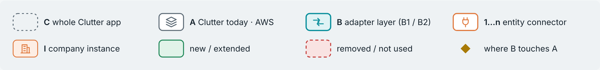
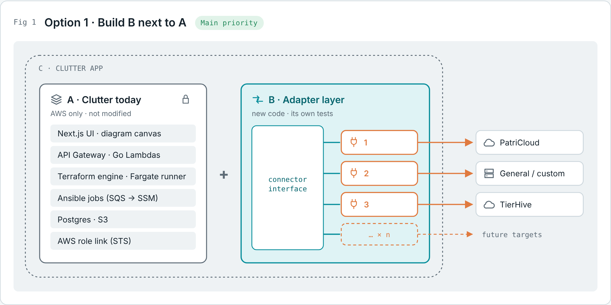
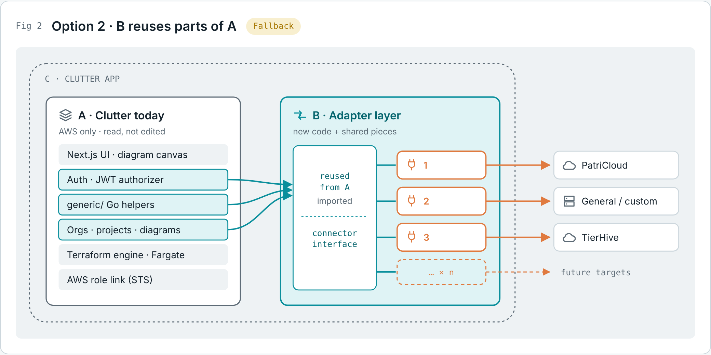
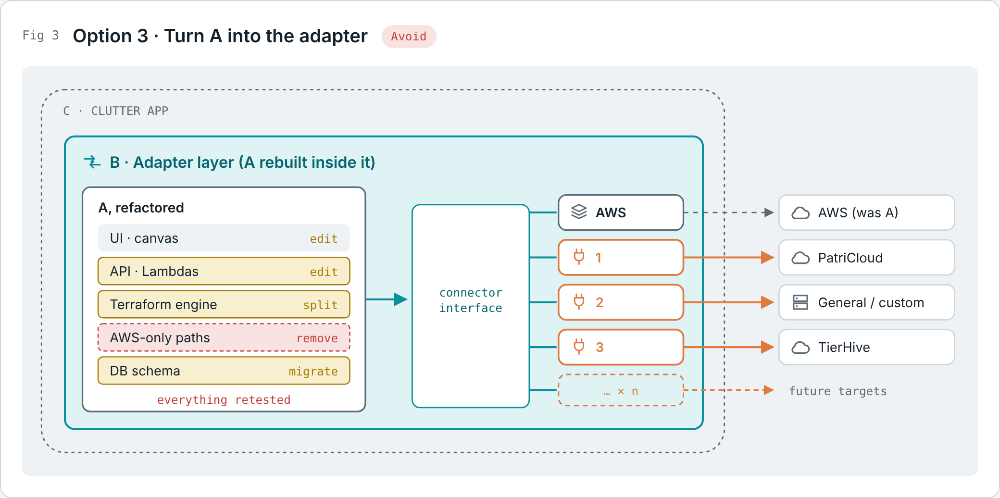
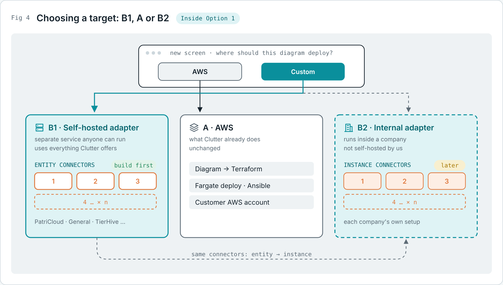
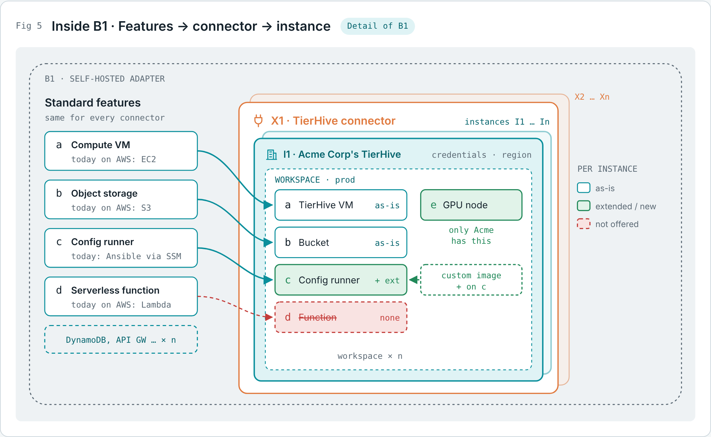
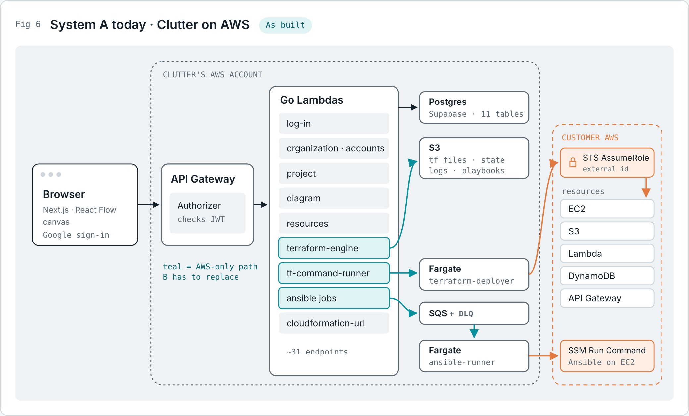
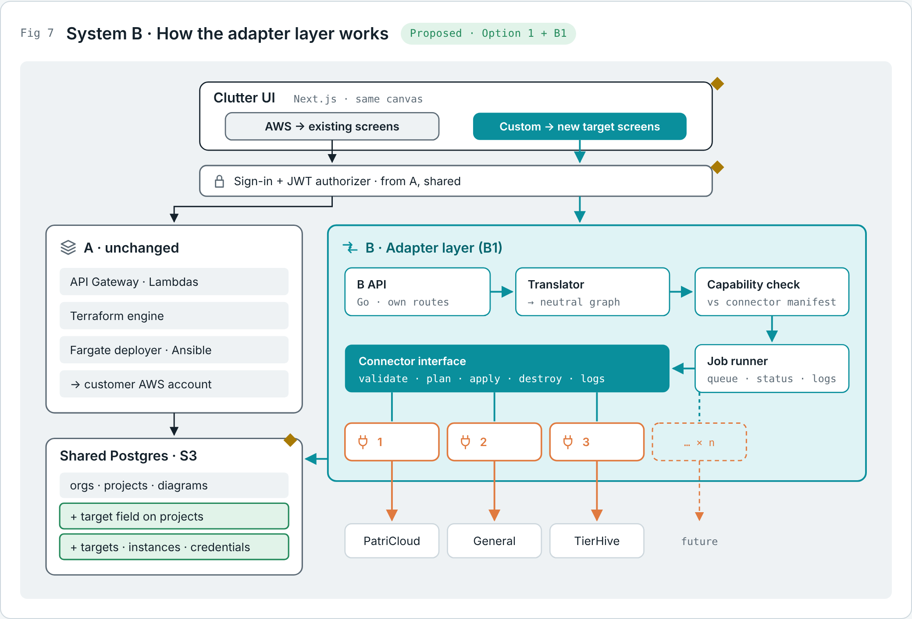
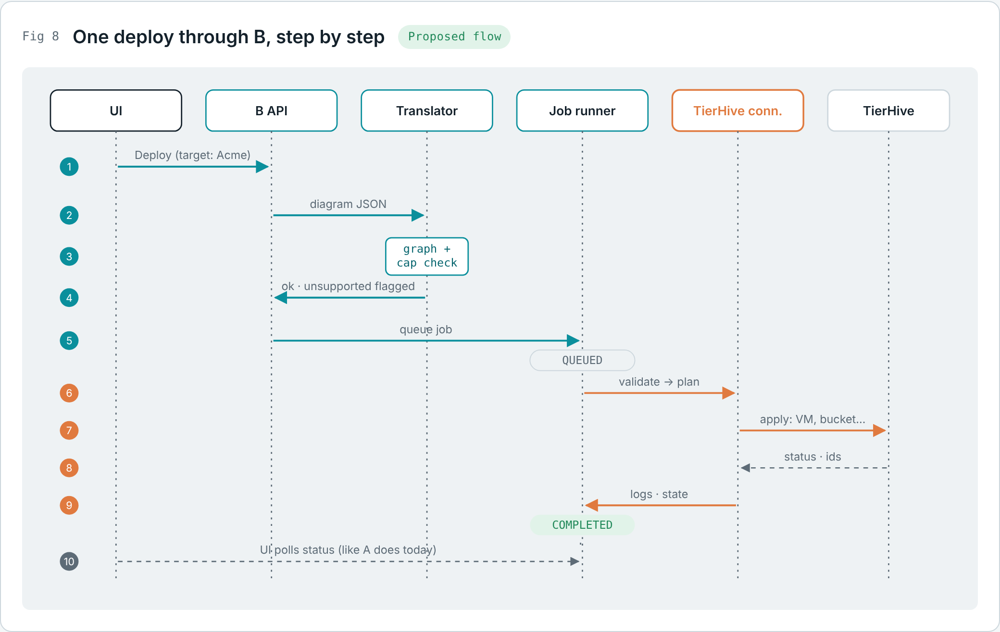
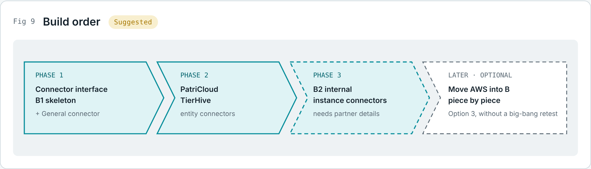

# The team's adapter-layer plan

Source material, written by the team on 2026-10-30: the figures in `figures/` (also bound together in `diagrams.pdf`) and the explanation below. The decisions taken from it are ADR-006 to ADR-008 in `docs/decisions.md`, and the design built on it is `docs/architecture/system-b-adapter-layer.md`, which owns the plan from here on. This file is kept as written.

## The context

**Clutter today** is a drag-and-drop canvas. A user places cloud resources on a diagram, Clutter turns that diagram into Terraform (plus Ansible for server setup) and deploys it into the user's own AWS account. It only works with AWS, and it is already built, tested and running.

**The goal** is to expand that same codebase so it can deploy to targets other than AWS. Examples are PatriCloud, a general option for custom setups, TierHive, and whatever comes later. You're doing this by building an **adapter layer**: one standard way for Clutter to talk to any target, with a separate **connector** for each target. The people who come after you should be able to add new connectors without reworking what already exists.

## The names

- **C**: the whole Clutter app, the big outer box in every diagram.
- **A**: Clutter as it exists today. It is the AWS system and already a complete, tested application.
- **B**: the adapter layer you're building.
- **1, 2, 3 … n**: **entity connectors**, one per target type (PatriCloud, General, TierHive, and so on). There can be any number of them.
- **B1**: the adapter shipped as a **self-hosted**, separate service that people can run and use.
- **B2**: the adapter as an **internal** thing a company runs inside its own setup, not self-hosted by you. In B2 the connectors become **instance connectors**.
- **X**: a connector (X1, X2 … Xn).
- **I**: an instance of a connector, meaning one specific company's setup of it (I1, I2 … In).
- **a, b, c, d … n**: the standard features or functions the adapter offers, which connectors and instances map onto.

## Level 1: three ways to attach B to A

### Fig 1 · Option 1: build B next to A (main priority)

A stays exactly as it is. B is a new, separate piece inside the same app that contains the connector interface, and connectors 1, 2, 3 … n plug into it.

The reason is testing. A is already a full working application. Changing anything in it means retesting and re-running it, so if you leave A alone, all of that stays safe. All new work and new tests live in B.

This split applies to both the backend (new services) and the frontend (new screens).

### Fig 2 · Option 2: B reuses parts of A (fallback)

The structure is the same as Option 1, but B reuses existing functions and code from A instead of rewriting them. That avoids copying or duplicating code and makes use of what already exists. How much gets reused depends on the code itself and how cleanly each part of A can be called from outside.

This is the fallback if Option 1 doesn't work out cleanly. The plan is to stay within Options 1 and 2.

From the repo: `backend/api/generic/` is the obvious candidate. It already holds shared Go helpers for responses, Postgres access, authorization and membership checks, and was written to be shared. Auth/JWT and the orgs, projects and diagrams data are also likely reuse points.

The trade-off: once B depends on parts of A, a change to those parts can break B. Those shared pieces need to be stable or have their own tests.

### Fig 3 · Option 3: turn A into the adapter (avoid)

This is what happens if you start from A and find that so much of it is nearly the same as what B needs that you convert A itself into the full adapter layer. That means editing A, removing AWS-only parts, splitting the Terraform engine and migrating the database. A gets absorbed into B, AWS becomes just one more connector, and B keeps expanding with the same connectors as the other options.

You want to avoid this because it means spending a lot of time adjusting and retesting all existing functionality, including every AWS path, before any new connector ships. System A essentially *is* the AWS side of Clutter, and you'd be rebuilding it.

## Level 2: inside B

### Fig 4 · Choosing a target: B1, A or B2

This zooms into the overall system once B exists.

On the frontend, a **new screen** asks where a diagram should deploy:

- **AWS** goes to System A, everything Clutter already does, unchanged.
- **Custom** goes to System B, the adapter layer, which can take one of two forms:
  - **B1, self-hosted adapter:** a separate service people can run themselves, with access to everything Clutter offers. Its connectors (1, 2, 3, 4 … n) are **entity connectors**, one per target type.
  - **B2, internal adapter:** the same adapter used internally by a company instead of self-hosted. The same connectors become **instance connectors**, because each company builds or configures its own.

So users can pick B1, A or B2.

Whether to do B2 at all is a separate decision. The overall order is: choose among Options 1/2/3, then decide B1 vs B2, and A stays as AWS either way.

B1 looks easier to build right now. B2 needs information you don't have yet: how connectors like TierHive and PatriCloud work inside those companies.

### Fig 5 · Inside B1: features → connector → instance

This goes one level further into B1.

- **Standard features** (a, b, c, d … n) are the functions every connector shares. To make them concrete, I used Clutter's real resource types: Compute VM (EC2 today), Object storage (S3), Config runner (Ansible via SSM), Serverless function (Lambda). DynamoDB, API Gateway and others continue the × n list.
- **X1** is a connector, e.g. TierHive. There can be X2 … Xn.
- **I1** is one instance of X1, e.g. one company's TierHive setup with its own credentials and region. There can be I2 … In. Inside it, a workspace (e.g. "prod") holds what gets deployed.

Each instance can treat each standard feature differently:

- **Used as-is:** the feature maps straight across with no changes (a: VM, b: bucket).
- **Extended:** the feature exists but gets new functionality for that connector or instance (c: config runner plus a custom image).
- **Removed / not used:** the feature doesn't apply to that instance (d: the target has no serverless functions).
- **New:** something only that instance has, outside the standard set (e: a GPU node).

The result is a fully mapped architecture. Shared functionality lives in one place, and differences live in the connector or instance, never in the standard set.

## Level 3: how it actually works

### Fig 6 · System A today (as built)

From the repo and the final report:

1. The **browser** runs the Next.js and React Flow canvas, with Google sign-in.
2. **API Gateway** checks every request with a JWT authorizer Lambda.
3. **Go Lambdas** each handle one domain: log-in, organization and accounts, project, diagram, resources, terraform-engine, tf-command-runner, ansible jobs and cloudformation-url. That's about 31 endpoints.
4. **Data:** Postgres (Supabase, 11 tables) and S3 (templates, .tf files, state, logs, playbooks).
5. **Deploy path:**
   - The **terraform-engine** reads the diagram JSON and fills Go templates from S3 to produce `main.tf` and `outputs.tf`, generating IAM policies from the diagram's edges.
   - The **tf-command-runner** starts a **Fargate terraform-deployer** task. That task assumes a role in the **customer's AWS account** (STS with an external ID, set up through a CloudFormation stack) and runs plan, apply or destroy.
   - **Ansible jobs** go through SQS (with a dead-letter queue) to a **Fargate ansible-runner**, which uses SSM Run Command to configure EC2.

The teal parts in the diagram are the AWS-only path. That's what B has to replace for other targets.

### Fig 7 · System B: how the adapter layer works (proposed)

This is how B would actually function under Option 1 with B1:

1. **Clutter UI:** the same canvas, plus the AWS / Custom choice. AWS goes to the existing screens and Custom goes to new target screens.
2. **Shared sign-in and JWT authorizer:** reused from A so users don't log in twice.
3. **A stays unchanged** on the AWS side.
4. **Inside B:**
   - **B API:** B's own Go service and routes.
   - **Translator:** converts the diagram into a neutral graph that isn't tied to AWS.
   - **Capability check:** compares the graph against what the chosen connector says it supports, and flags unsupported pieces before deployment.
   - **Job runner:** queues the job and tracks status and logs, like A does today.
   - **Connector interface:** one contract every connector implements, covering validate, plan, apply, destroy and logs.
   - **Connectors 1, 2, 3 … n** talk to PatriCloud, General, TierHive and future targets.
5. **Shared Postgres and S3:** existing orgs, projects and diagrams, plus a target field on projects and new tables for targets, instances and credentials.

The gold diamonds mark the **three places B touches A**: the UI target choice, shared sign-in, and the shared database with the new target field and tables. Even in Option 1, these are the unavoidable connection points.

### Fig 8 · One deploy through B, step by step

1. The user clicks Deploy in the UI, choosing a target (e.g. Acme's TierHive).
2. B API sends the diagram JSON to the translator.
3. The translator builds the neutral graph and runs the capability check.
4. The result goes back: OK, with any unsupported features flagged.
5. B API queues the job (status QUEUED).
6. The job runner calls the TierHive connector: validate, then plan.
7. The connector applies on TierHive, creating the VM, bucket and so on.
8. TierHive returns status and resource IDs.
9. The connector sends logs and state back to the job runner (status COMPLETED).
10. The UI polls for status, the same way A does today.

### Fig 9 · Build order (suggested)

1. **Phase 1:** the connector interface, the B1 skeleton and the General connector.
2. **Phase 2:** the PatriCloud and TierHive entity connectors.
3. **Phase 3:** B2 and instance connectors, once you have partner details.
4. **Later, optional:** move AWS into B piece by piece. This reaches Option 3's clean end state without a big-bang retest.

## Assessment and recommendations

Overall the plan is sound. The figures form a clear chain:

- how B attaches to A (Option 1 preferred, 2 as fallback, 3 avoided)
- which target users pick (B1 now, B2 later, A always available)
- how features map onto connectors and instances

Things to settle before coding:

1. **"Don't touch A" really means "touch A only at the seams."** Shared sign-in, the frontend target choice, and a field saying which target a project uses are unavoidable. Name them up front so Option 1 doesn't drift into Option 2 without anyone deciding it.
2. **Define the connector interface first.** Something like validate → plan → apply → destroy → logs, mirroring what A's Terraform runner already does. Every connector, and B2 later, implements the same contract.
3. **The diagram engine is the hardest part.** A's Terraform engine is built around AWS resources and IAM rules. Each connector needs its own mapping from the same diagram. Decide early whether connectors output Terraform for other providers, call target APIs directly, or both.
4. **Make connectors declare their capabilities.** Each connector lists which features it supports, extends or drops (Fig 5's as-is / extended / removed / new). The UI can then hide what a target can't do instead of failing at deploy time.
5. **Pin down entity vs instance.**
   - An *entity connector* is a target type, like TierHive.
   - An *instance* is one company's configured setup of it.
   - In B1, instances can just be configuration (credentials, region, workspace).
   - In B2, instances become code each company owns.
6. **Keep Option 3 as a possible destination, not the starting move.** If B's interface is general enough for AWS to fit, A can migrate into it gradually, whenever that's worth it.

## Open questions

- How do TierHive and PatriCloud expose their infrastructure (Terraform providers, APIs, something else)? This decides how connectors are built and whether B2 is realistic.
- What does "General / custom" mean concretely? Plain Terraform for any provider, or a generic API format?
- Does B1 run as Lambdas like A, or as a long-running container, given that self-hosters need to run it outside your AWS account?
- Where are connector credentials stored, and how are they secured for each instance?

Answers so far (TierHive and Patrii research, the General default, the container default) are in `docs/architecture/system-b-adapter-layer.md` and `.claude/findings/NOW.md`.
