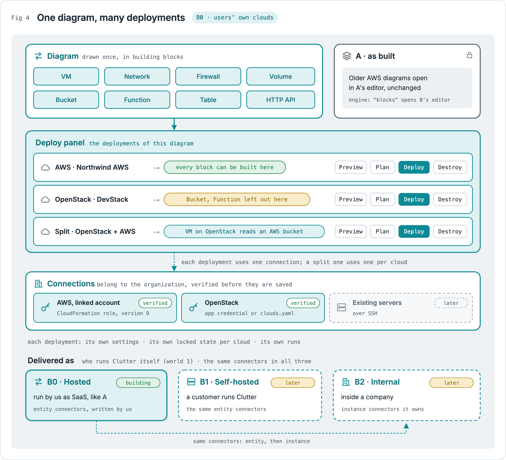
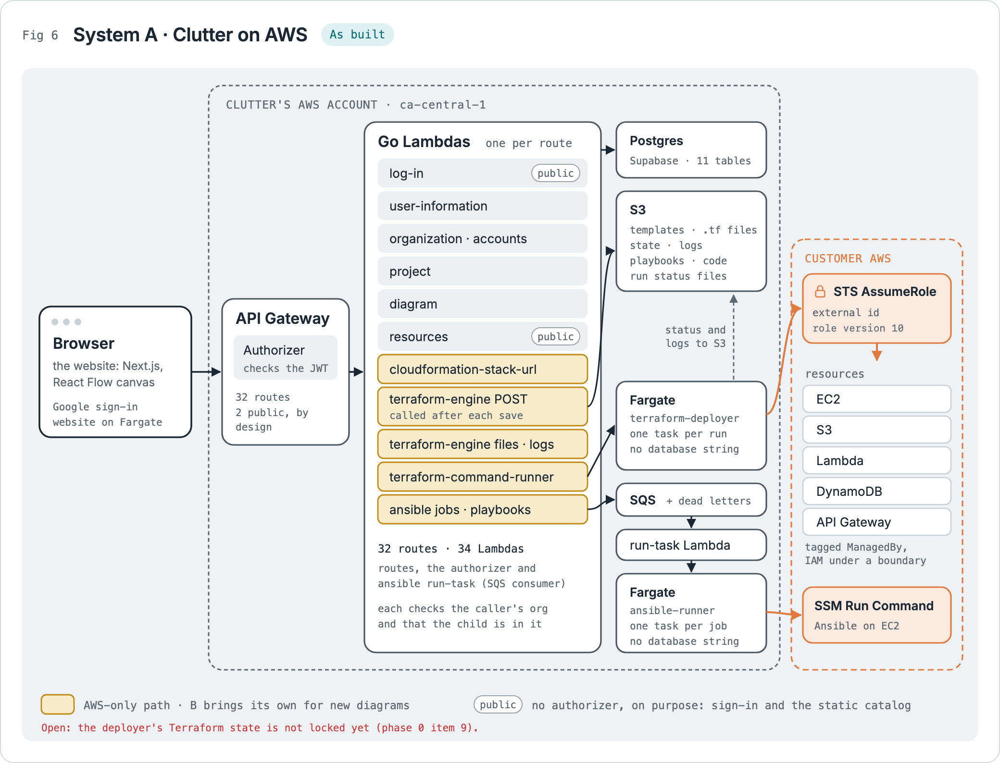
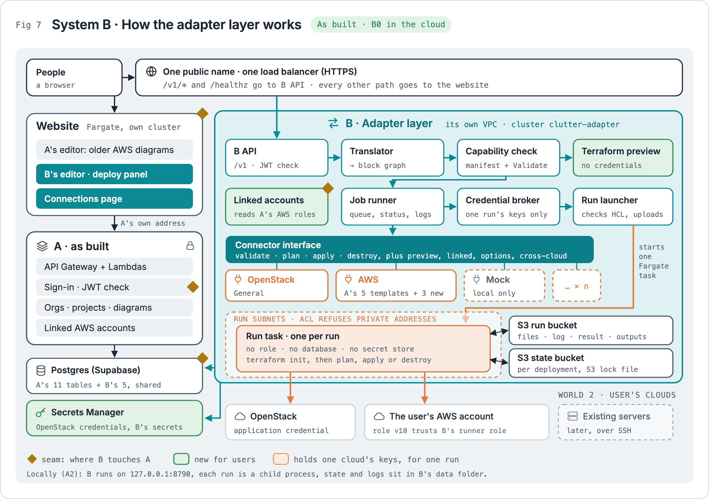
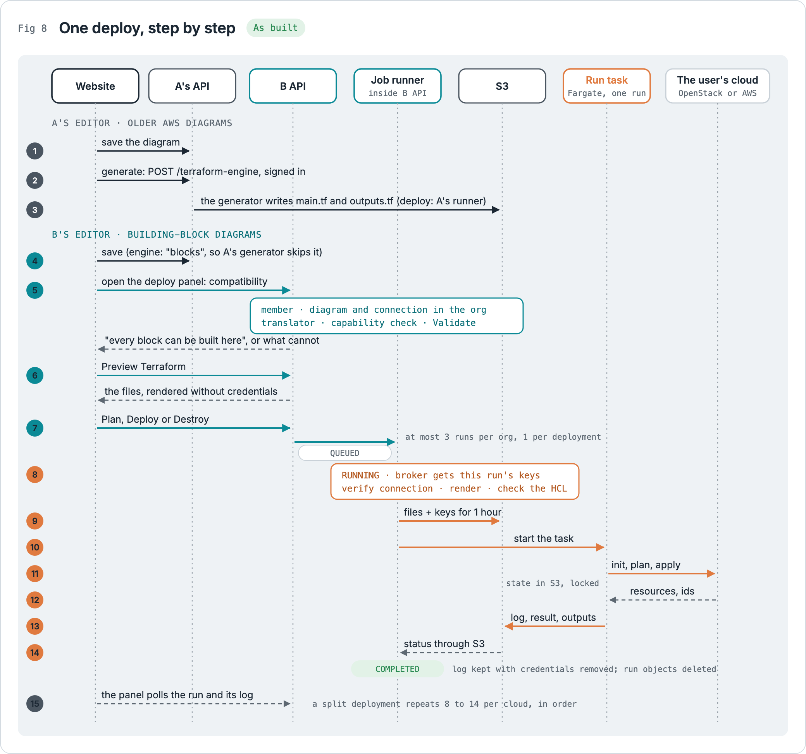
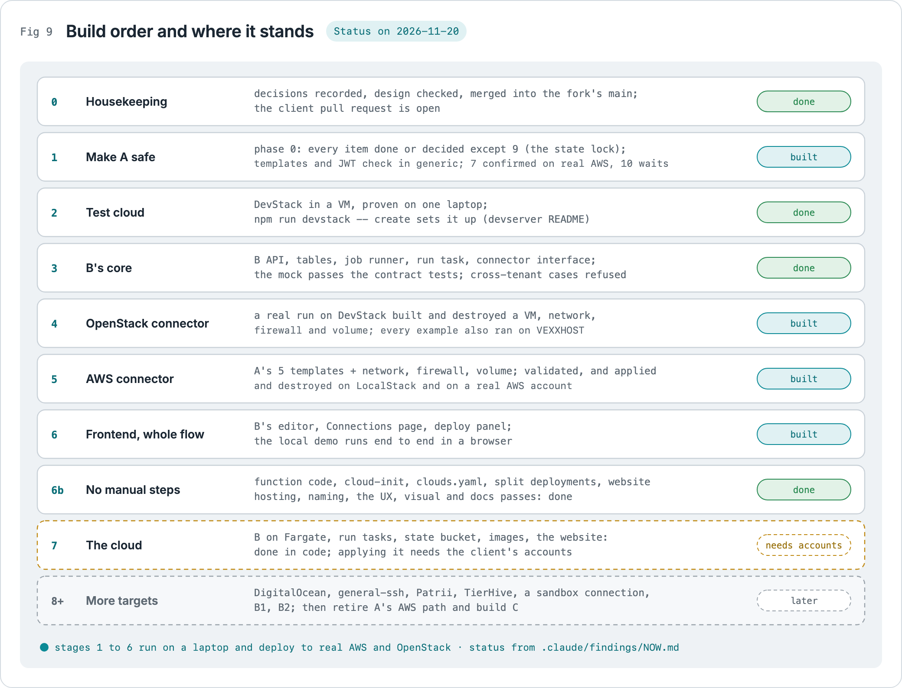

# The team's adapter-layer plan

The team's plan, redrawn to match the code. `docs/architecture/system-b-adapter-layer.md` owns the details. The figures are in `figures/` (also bound together in `diagrams.pdf`). The overall picture is `docs/architecture/figures/clutter-worlds.png`.

## The context

**Clutter today** is a drag-and-drop canvas. A user places cloud resources on a diagram, Clutter turns that diagram into Terraform (plus Ansible for server setup) and deploys it into the user's own AWS account. It only works with AWS. It is built and tested (`docs/architecture/system-a-as-built.md`).

**The goal** is to expand that same codebase so it can deploy to targets other than AWS. First General, which reaches many clouds through approved Terraform providers (OpenStack first), then AWS through B, then PatriCloud, TierHive and whatever comes later. The team does this by building an **adapter layer**: one standard way for Clutter to talk to any target, with a separate **connector** for each target. Later teams can add new connectors without reworking what already exists.

## The letters in the figures

Every name is defined once in `docs/architecture/system-b-adapter-layer.md` § Names. The figures use these letters:

- **C**: the whole Clutter app, the big outer box in every diagram.
- **A**, **A2**, **B**, **B0**, **B1**, **B2**: as in § Names.
- **1, 2, 3 … n**, or **X1 … Xn**: connectors.
- **I1 … In**: connections.
- **a, b, c, d … n**: building blocks.

## Level 1: three ways to attach B to A

### Fig 1 · Option 1: build B next to A (chosen)

A stays as it is, except stage 1's security fixes and the moves that make its template loader and JWT check shareable (ADR-006). B is a new, separate piece inside the same app that contains the connector interface, and connectors 1, 2, 3 … n plug into it. As built, B is `backend/adapter`, with three connectors: General's OpenStack connector, the AWS connector (A's five templates plus network, firewall and volume), and a mock connector for local tests only. The website is one app for A and B (ADR-024): a diagram opens in A's editor or B's editor, chosen per diagram.

The reason is testing. A is already a full working application. Changing anything in it means retesting and re-running it, so if you leave A alone, all of that stays safe. All new work and new tests live in B.

This split applies to both the backend (new services) and the frontend (new screens).

### Fig 2 · Option 2: B reuses parts of A (fallback)

The structure is the same as Option 1, but B reuses existing functions and code from A instead of rewriting them. That avoids copying or duplicating code and makes use of what already exists. How much gets reused depends on the code itself and how cleanly each part of A can be called from outside.

This is the fallback if Option 1 doesn't work out cleanly. The plan is to stay within Options 1 and 2.

From the repo: B already imports A's `backend/api/generic` package (the JWT check, the name check and the template loader), reads A's organization, project, diagram and linked AWS account tables, and renders A's five AWS template files. The figure marks these in teal. All of them sit at the named seams, so they are Option 1 as planned; reuse beyond them is what Option 2 would add.

The trade-off: once B depends on parts of A, a change to those parts can break B. Those shared pieces need to be stable or have their own tests.

### Fig 3 · Option 3: turn A into the adapter (later, piece by piece)

This is what happens if you start from A and find that so much of it is nearly the same as what B needs that you convert A itself into the full adapter layer. That means editing A, removing AWS-only parts, splitting the Terraform engine and migrating the database. A gets absorbed into B, AWS becomes just one more connector, and B keeps expanding with the same connectors as the other options.

It is never the first move, because it means adjusting and retesting all existing functionality, including every AWS path, before any new connector ships. System A essentially *is* the AWS side of Clutter. It stays a later destination, reached piece by piece: once B's AWS path passes on real AWS, A's own AWS machinery is removed, and A's core (sign-in, organizations, projects, diagrams and the AWS account link) moves into B's service under `/v1`. That one system is C (ADR-021), drawn in `docs/architecture/figures/clutter-c.png`.

## Level 2: inside B

### Fig 4 · One diagram, many deployments

This zooms into the overall system once B exists, as a user sees it.

- A diagram is drawn **once**, in the eight building blocks.
- Each cloud it runs on is a **deployment**: the diagram, one **connection**, that cloud's settings, and its own Terraform state and runs. The deploy panel lists them, with a line saying whether each cloud can build everything ("every block can be built here"), or which blocks it leaves out. Each row has Preview Terraform, Plan, Deploy and Destroy, and shows the run's log.
- A **split deployment** places some blocks on another of the organization's clouds. A VM can get another cloud's VM address, or read a bucket or table there with a scoped key that Clutter creates and deletes (ADR-020).
- **Connections** belong to the organization and are linked once on the Connections page: an AWS account through the CloudFormation role, or an OpenStack application credential or `clouds.yaml` file (servers over SSH later), each verified before it is saved.
- Diagrams made before B (AWS-only) keep opening in A's editor, unchanged; a diagram marked `engine: "blocks"` opens in B's editor.

There is no per-diagram "AWS or Custom" choice: deployments replace it. A diagram is not tied to one cloud, so the user never has to pick one up front.

B can be delivered three ways, and the same connectors serve all three:

- **B0, hosted adapter:** run by us as SaaS, like A. **Built first**, because it proves B with the least setup and support work.
- **B1, self-hosted adapter:** a separate service people run themselves, with access to everything Clutter offers. Its connectors (1, 2, 3, 4 … n) are **entity connectors**, one per target type, written by us. It stays possible because B accepts any Postgres and any S3-compatible store.
- **B2, internal adapter:** the same adapter used inside a company. Its connectors become **instance connectors**, because each company builds or configures its own.

The overall order of decisions is: choose among Options 1/2/3 (Option 1), then the delivery model (B0 first), and A stays as AWS either way (B's AWS connector reuses A's template files). Whether to do B2 at all is a separate decision: it needs information we do not have yet, namely how targets such as TierHive and PatriCloud work inside the companies that use them.

### Fig 5 · Building blocks → connector → connection

This goes one level further into B.

- **Building blocks** (a … h) are the same for every connector: VM, network, firewall, volume, bucket, function, table, HTTP API. Their fields are owned once, in `backend/adapter/connectors/blocks.go`. The left column shows what each becomes on AWS. Server setup is the VM's startup script, run by cloud-init at first boot on every cloud.
- **X** is a connector, here General's OpenStack connector. Its **manifest** says how it treats each block. There are X2 … Xn: AWS and the mock (built), and later DigitalOcean, PatriCloud and TierHive.
- **I** is one connection for X: one organization's OpenStack, with its own credential and region. There can be I2 … In. Each **deployment** that uses it has its own settings (image, flavors), exclusions and state.

Each connector can treat each block differently:

- **As-is:** the block maps straight across. On OpenStack a VM becomes a Nova server (with a floating IP when it is public), a network becomes a network, subnet and router, a firewall a security group, and a volume a Cinder volume.
- **Extended:** the block exists with more for this connector or connection (for example, a custom image).
- **Removed:** the block does not apply (OpenStack here has no bucket, function, table or HTTP API); a deployment can leave such a block out.
- **New:** something only this connector has, outside the standard set (for example, a GPU flavor).

No connector uses "extended" or "new" yet; the figure marks those two as examples.

Shared behaviour lives in the building blocks. Differences live in the connector's manifest, never in the standard set.

## Level 3: how it actually works

### Fig 6 · System A (as built)

From the repo:

1. The **browser** runs the website (Next.js and the React Flow canvas, on Fargate in the cloud), with Google sign-in.
2. **API Gateway** checks requests with a JWT authorizer Lambda. Two routes have no authorizer on purpose: `POST /log-in` and `GET /resources` (the static catalog). Generation is signed in, and the editor calls it after each save (ADR-018).
3. **Go Lambdas** each handle one domain: log-in, user information, organization and accounts, project, diagram, resources, terraform-engine, terraform-command-runner, ansible jobs and cloudformation-stack-url. Each handler checks that the caller is a member of the organization and that the project, diagram or run belongs to it.
4. **Data:** Postgres (Supabase) and S3 (templates, .tf files, state, logs, playbooks, code uploads and run status files).
5. **Deploy path:**
   - The **terraform-engine** reads the saved diagram and fills Go templates from S3 to produce `main.tf` and `outputs.tf`, generating IAM policies from the diagram's edges.
   - The **terraform-command-runner** starts one **Fargate terraform-deployer** task per run. That task assumes a role in the **customer's AWS account** (STS with an external ID, set up through a CloudFormation stack) and runs plan, apply or destroy. It holds no database string; it writes its status and logs to S3, and the API records the status.
   - **Ansible jobs** go through SQS (with a dead-letter queue) to the `ansible/run-task` Lambda, which starts a **Fargate ansible-runner** that uses SSM Run Command to configure EC2. It also holds no database string.
   - The customer role changes only resources tagged `ManagedBy`, and every role and user it creates sits under a permissions boundary.

The amber parts in the diagram are the AWS-only path. B brings its own for new diagrams, on every cloud. A's open defects are in `.claude/findings/NOW.md` § Open defects in A.

### Fig 7 · System B: how the adapter layer works (as built)

This is B as built, delivered as B0 in the cloud:

1. **One public name:** a load balancer sends `/v1/*` and `/healthz` to B API and every other path to the website (ADR-023).
2. **Website:** one app for A and B (ADR-024), on its own Fargate cluster. Older AWS diagrams open in A's editor; building-block diagrams open in B's editor, with the deploy panel and the Connections page.
3. **A stays unchanged** on its AWS path, behind its own API Gateway address. B reuses A's sign-in (the JWT check in `generic`), A's organizations, projects and diagrams, and A's linked AWS accounts.
4. **Inside B** (its own VPC and the ECS cluster `clutter-adapter`):
   - **B API:** one Go service on Fargate, with the `/v1` routes; it checks the JWT.
   - **Translator** and **capability check:** turn the diagram into a graph of building blocks, and check it against the connector's manifest and its `Validate`.
   - **Terraform preview:** renders a deployment's Terraform without any credentials.
   - **Linked accounts:** lists the AWS accounts the organization linked in A, so an AWS account is linked once.
   - **Job runner:** queues each run (at most 3 per organization), tracks its status and keeps its log with credential values removed.
   - **Credential broker:** fetches one run's credentials: short-lived AWS keys from STS, or the one connection's secret from Secrets Manager.
   - **Run launcher:** checks the rendered HCL, uploads the run's files and one-hour keys to the S3 run bucket, and starts one Fargate run task.
   - **Run task:** in its own run subnets, whose network ACL refuses private addresses; it has no role, no database and no secret store. It runs `terraform init` against the S3 state bucket (locked by an S3 lock file), then plan, apply or destroy, and writes its log, result and outputs back to S3. The job runner reads its status from there.
   - **Connector interface:** validate, plan, apply and destroy, plus the optional preview, linked accounts, option lists and cross-cloud parts.
   - **Connectors:** General's OpenStack, AWS (A's 5 templates plus network, firewall and volume) and the mock (local only); more General providers, PatriCloud and TierHive later.
5. **Shared Postgres:** A's tables plus B's (connections, deployments, runs, function code, placements). OpenStack credentials and B's own secrets sit in Secrets Manager.

Locally (A2), B runs on `127.0.0.1:8790`, each run is a child process, and state and logs sit in B's data folder.

The gold diamonds mark the **places B touches A**: the UI, shared sign-in, the shared database and A's linked AWS accounts. The fourth seam is the security fixes on paths B shares with A. Even in Option 1, these are the unavoidable connection points.

### Fig 8 · One deploy, step by step (as built)

Steps 1 to 3 are A's editor (older AWS diagrams); steps 4 to 15 are B's editor (building-block diagrams).

1. The user saves the diagram.
2. The editor then calls `POST /terraform-engine` with the user's token.
3. The generator writes `main.tf` and `outputs.tf` to S3; A's own runner deploys them.
4. The user saves the diagram. It is marked `engine: "blocks"`, so A's generator skips it.
5. The deploy panel asks B API for each deployment's compatibility. B API checks that the user is a member, and that the diagram and the connection belong to the organization, then runs the translator, the capability check and the connector's `Validate`. The answer is "every block can be built here", or what cannot.
6. Preview Terraform shows the files, rendered without credentials.
7. Plan, Deploy or Destroy starts a run (status QUEUED), at most 3 per organization and 1 per deployment.
8. The job runner marks it RUNNING. The broker fetches only this run's keys; the connector verifies the connection, renders the Terraform, and B refuses anything unsafe in it.
9. B uploads the run's files and one-hour keys to the S3 run bucket.
10. B starts one Fargate run task.
11. The task runs `terraform init` (state in S3, locked), then plan or apply against the user's cloud.
12. The cloud returns the resources and their IDs.
13. The task writes its log, result and outputs to S3.
14. The job runner reads the status through S3, keeps the log with credential values removed, deletes the run's objects, and marks the run COMPLETED (or FAILED).
15. The deploy panel polls the run and its log.

A split deployment repeats steps 8 to 14 once per cloud, in dependency order, each in its own task with only that cloud's keys.

### Fig 9 · Build order

The build runs in stages 0 to 8. Stages 1 to 6 run and are tested on a laptop; stage 7 is the cloud; stage 8 adds more targets, B1 and B2, then retires A's AWS path and builds C (ADR-021). Each stage's work is in `docs/architecture/implementation-plan.md`. Each stage's status is in `.claude/findings/NOW.md` § The order.

## Questions

The plan's first questions (how targets expose their APIs, what General means, where B runs, where credentials live) are answered in `docs/architecture/system-b-adapter-layer.md` and `docs/decisions.md`. What is still open is in `.claude/findings/NOW.md` § Open questions.
